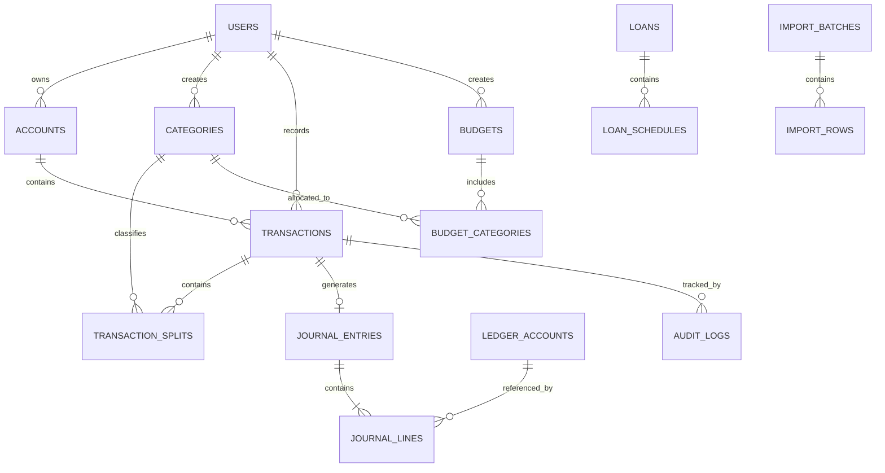

      # UNIFIED PERSONAL FINANCE MANAGEMENT APPLICATION
## Complete Product Requirements, Business Logic, Technical Architecture and Development Specification

**Project:** Unified Personal Finance Management Application  
**Project version:** 1.0  
**Document status:** Master Specification — Initial Baseline  
**Target market:** India  
**Default currency:** INR (₹)  
**Platforms:** Web Application + Android Application  
**Web technology:** React + TypeScript  
**Mobile technology:** React Native + TypeScript + Expo  
**Backend:** Node.js + TypeScript + Fastify  
**Database:** SQLite-compatible libSQL  
**API architecture:** REST + JSON  
**Product philosophy:** One application. One financial ecosystem. One source of financial truth.

---

# TABLE OF CONTENTS

1. Product Vision
2. Product Objectives
3. Product Principles
4. Reference Applications
5. Target Users
6. Complete Application Modules
7. User Registration and Onboarding
8. Financial Account Management
9. Opening Balance Management
10. Accounting and Ledger Architecture
11. Income Management
12. Expense Management
13. Transfer Management
14. Transaction Management
15. Categories and Payees
16. Dashboard and Financial Overview
17. Budget Management
18. Recurring Transactions
19. Loan Management
20. EMI Management
21. Credit Card Management
22. Debt and Liability Management
23. Bank Statement Import
24. UPI and Notification-Based Expense Capture
25. Financial Reports and Analytics
26. Search, Filters and Transaction Editing
27. Multi-Device Synchronization
28. Web Application Requirements
29. Android Application Requirements
30. Backend Architecture
31. Complete Database Design
32. Complete API Requirements
33. Financial Business Rules
34. Security and Privacy
35. Error Handling and Audit Logging
36. Notifications and Reminders
37. Remote Configuration
38. Data Export and Backup
39. Non-Functional Requirements
40. Complete Testing Strategy
41. Financial Regression Scenarios
42. Acceptance Criteria
43. Technology Stack
44. Project Folder Structure
45. Development Phases
46. Definition of Done
47. Future Enhancements
48. Final Product Vision

---

# 1. PRODUCT VISION

The objective is to create one comprehensive Personal Finance Management application that allows an individual to manage their entire financial life from a single platform.

The application must not be limited to expense tracking.

It should combine the functionality of:

- Personal expense trackers.
- Income management systems.
- Bank account trackers.
- Cash management applications.
- Budget planners.
- Credit card managers.
- Loan and EMI trackers.
- Financial reporting tools.
- Bank statement import utilities.
- UPI expense trackers.
- Financial planning applications.

Users should not need separate applications to manage different financial activities.

Every module must communicate with the same backend, database, accounting engine and financial calculation system.

## 1.1 Core product statement

**One application for all personal financial services.**

The user should be able to understand:

- How much money they have.
- Where their money is located.
- How much they earn.
- How much they spend.
- Where they spend their money.
- How much they owe.
- How much others owe them.
- How much they save.
- How much they invest.
- How much they need to pay in the future.
- Whether their financial position is improving or declining.

## 1.2 Product references

The initial product references are:

1. Buckwheat: https://buckwheat.app/
2. BudgetBakers Wallet: https://web.budgetbakers.com/sign-in?callbackUrl=%2Fonboarding

Use these products as functional and usability references.

Our application should combine simplicity, comprehensive financial management, useful analytics and convenient data entry.

We must create our own branding, user experience and implementation.

---

# 2. PRODUCT OBJECTIVES

The application must achieve the following objectives.

1. Allow users to manage all personal financial activities in one place.
2. Provide a clean ledger for new users.
3. Allow existing balances to be entered as opening balances.
4. Track income and expenses accurately.
5. Support multiple bank accounts and cash accounts.
6. Support transfers between accounts.
7. Track credit card outstanding amounts.
8. Track loans, EMIs and repayment schedules.
9. Provide daily, weekly, monthly and yearly financial summaries.
10. Allow users to create and monitor budgets.
11. Import bank statements from different file formats.
12. Detect duplicate transactions.
13. Capture payment notifications on Android with user permission.
14. Synchronize financial information between Web and Android.
15. Maintain a reliable accounting ledger.
16. Provide financial reports and net-worth calculations.
17. Allow users to edit, correct, export and review their data.
18. Keep the application free-first wherever practical.
19. Maintain one centralized business logic layer.
20. Ensure financial calculations are consistent across every platform.

---

# 3. PRODUCT PRINCIPLES

These principles are mandatory throughout development.

## 3.1 One application

Do not develop separate applications for:

- Expenses.
- Budgets.
- Loans.
- Credit cards.
- Statements.
- Reports.

All of these are modules inside one application.

## 3.2 One backend

Web and Android must communicate with the same backend.

The same API must produce the same financial result regardless of the client.

## 3.3 One accounting engine

All financial calculations must be centralized.

Do not implement different account-balance or expense calculations independently inside Web and Android.

## 3.4 One source of truth

The backend ledger is authoritative.

Frontend calculations are for presentation only. Financial balances and reports must be calculated or verified by backend services.

## 3.5 Modular development

Each feature should be implemented as an independent module with clear boundaries.

Modules must still use common financial data and accounting rules.

## 3.6 Financial accuracy

Every transaction must have a defined accounting effect.

Transfers must not become expenses. Credit card bill payments must not duplicate purchases. Loan principal repayment must not be incorrectly classified as interest expense.

## 3.7 Auditability

Financial records must be traceable.

A posted financial entry should not be silently deleted or overwritten.

## 3.8 Free-first technology

Prefer:

- Open-source frameworks.
- Free development tools.
- Free local development environments.
- Open-source test frameworks.
- Free tiers where appropriate.

However, production hosting, backups, domains, storage and managed database services may eventually require payment.

---

# 4. TARGET USERS

The application initially targets individuals who want to manage their personal finances.

Primary user types:

- Salaried employees.
- Self-employed individuals.
- Small business owners managing personal finances.
- Individuals managing multiple bank accounts.
- People with credit cards and EMIs.
- Individuals tracking cash and UPI transactions.
- People planning monthly expenses and savings.

The initial implementation should prioritize Indian financial workflows:

- INR.
- Indian bank accounts.
- UPI payments.
- Salary credits.
- Credit cards.
- Personal loans.
- Home loans.
- Vehicle loans.
- EMI schedules.
- Bank statement imports.

The architecture should allow additional currencies and regional financial rules later.

---

# 5. COMPLETE APPLICATION MODULES

The application must eventually contain the following modules.

| Module | Primary responsibility |
|---|---|
| Authentication | Registration and login |
| User Profile | Personal settings |
| Dashboard | Financial overview |
| Accounts | Bank, cash and other accounts |
| Opening Balances | Initial financial position |
| Transactions | All financial activities |
| Income | Salary and other earnings |
| Expenses | Daily and recurring spending |
| Transfers | Movement between accounts |
| Categories | Financial classification |
| Payees | Merchants and recipients |
| Budgets | Spending limits |
| Recurring Payments | Scheduled transactions |
| Loans | Borrowing management |
| EMIs | Installment tracking |
| Credit Cards | Card spending and bills |
| Liabilities | Outstanding financial obligations |
| Imports | Bank statement processing |
| Notification Capture | Android payment detection |
| Reports | Financial analytics |
| Net Worth | Assets minus liabilities |
| Synchronization | Multi-device consistency |
| Settings | Application configuration |
| Export | Data portability |
| Audit | Financial activity history |

---

# 6. USER REGISTRATION AND ONBOARDING

## 6.1 Registration

Users should be able to register using an approved authentication method.

Initial options:

- Email and password.
- Email verification.
- Password recovery.
- Session management.

Social sign-in can be added later.

## 6.2 User profile

Required information:

- User ID.
- Display name.
- Email.
- Preferred currency.
- Country.
- Time zone.
- Date format.
- Number format.
- Created date.
- Updated date.

Default configuration for the initial India-focused product:

- Currency: INR.
- Country: India.
- Time zone: Asia/Kolkata.
- Number format: Indian numbering system.

## 6.3 Onboarding workflow

1. User registers.
2. User verifies their account.
3. User selects personal preferences.
4. User chooses the primary currency.
5. User creates their first financial account.
6. User enters an opening balance, if applicable.
7. User optionally creates additional accounts.
8. User optionally configures salary and recurring payments.
9. User enters the dashboard.

## 6.4 Clean ledger requirement

A new user must begin with an empty transaction history.

Existing money should be entered as opening balances.

Opening balances must not be treated as new salary or income.

## 6.5 Onboarding completion

Track onboarding status so users can resume unfinished setup.

Do not force users to create every possible account or financial module during registration.

---

# 7. FINANCIAL ACCOUNT MANAGEMENT

## 7.1 Supported account types

The application should support:

1. Savings account.
2. Current account.
3. Salary account.
4. Cash / wallet.
5. Fixed deposit.
6. Recurring deposit.
7. Credit card.
8. Personal loan.
9. Home loan.
10. Vehicle loan.
11. Other asset.
12. Other liability.

Some account types may use specialized behavior.

For example, a credit card is normally a liability account rather than a positive cash account.

## 7.2 Account information

Each account should support:

- Account ID.
- User ID.
- Account name.
- Account type.
- Institution name.
- Masked account number.
- Currency.
- Opening date.
- Opening balance.
- Current balance.
- Account status.
- Notes.
- Created timestamp.
- Updated timestamp.

Never store complete banking credentials or online banking passwords.

## 7.3 Account operations

Users must be able to:

- Create accounts.
- View accounts.
- Edit account details.
- Archive accounts.
- Reopen archived accounts, subject to policy.
- View account transaction history.
- View account balance history.
- Set account opening balances.
- View total account balances.

An account with financial history should not be physically deleted through an ordinary delete operation.

Archiving should prevent normal future use without destroying historical records.

## 7.4 Account balance calculation

Account balance must be derived from the opening position and posted accounting entries.

For an asset account:

Current balance = Opening balance + Debits - Credits

For a liability account under the selected accounting convention:

Current liability = Opening liability + Credits - Debits

The accounting engine must define and consistently apply the debit/credit convention.

Do not independently increment and decrement stored account balances from multiple API endpoints.

---

# 8. OPENING BALANCE MANAGEMENT

Opening balances establish the financial position at the beginning of the user's ledger.

Example:

| Account | Type | Opening balance |
|---|---|---:|
| HDFC Bank | Bank | ₹35,000 |
| SBI Savings | Savings | ₹20,000 |
| Cash Wallet | Cash | ₹3,000 |
| Credit Card | Liability | ₹12,000 |
| Personal Loan | Liability | ₹80,000 |

Total opening assets = ₹58,000.

Total opening liabilities = ₹92,000.

Opening net worth = -₹34,000.

## 8.1 Opening balance rules

1. Opening balance must have an effective date.
2. Opening balance must create appropriate accounting entries.
3. Opening balances must not be reported as salary.
4. Opening balances must not be reported as expenses.
5. Opening balances must be included in account balances and net worth.
6. Opening balances must be auditable.
7. Opening balances must be editable only through a controlled adjustment process.
8. A user must not accidentally create multiple opening entries for the same account.

## 8.2 Opening balance accounting

For assets:

- Debit the asset account.
- Credit the opening balance equity account.

For liabilities:

- Credit the liability account.
- Debit the opening balance equity account.

This ensures the journal remains balanced.

If an opening balance is corrected, create a reversing and replacement entry or a controlled adjustment.

---

# 9. ACCOUNTING AND LEDGER ARCHITECTURE

This is the most important technical component of the application.

All financial features must use the same accounting engine.

## 9.1 Double-entry accounting

Every posted journal entry must satisfy:

Total Debits = Total Credits

A journal entry consists of:

- Journal entry header.
- One or more journal lines.
- Effective date.
- Description.
- Source transaction.
- Posting status.
- Audit metadata.

## 9.2 Account classes

The initial chart of accounts should support:

1. Assets.
2. Liabilities.
3. Equity.
4. Income.
5. Expenses.

## 9.3 Account balance rules

Using the normal-balance convention:

| Account class | Normal balance | Increase |
|---|---|---|
| Assets | Debit | Debit |
| Expenses | Debit | Debit |
| Liabilities | Credit | Credit |
| Equity | Credit | Credit |
| Income | Credit | Credit |

## 9.4 Example: Salary credit

Salary received: ₹50,000.

Journal:

| Account | Debit | Credit |
|---|---:|---:|
| Bank Account | ₹50,000 | |
| Salary Income | | ₹50,000 |

Result:

- Bank balance increases by ₹50,000.
- Income increases by ₹50,000.

## 9.5 Example: Cash expense

Expense: ₹2,000.

| Account | Debit | Credit |
|---|---:|---:|
| Food Expense | ₹2,000 | |
| Bank Account | | ₹2,000 |

Result:

- Expense increases.
- Bank balance decreases.

## 9.6 Example: Bank-to-cash transfer

Transfer: ₹5,000.

| Account | Debit | Credit |
|---|---:|---:|
| Cash Account | ₹5,000 | |
| Bank Account | | ₹5,000 |

Result:

- Bank decreases by ₹5,000.
- Cash increases by ₹5,000.
- Total assets remain unchanged.
- Income and expenses remain unchanged.

## 9.7 Example: Credit card purchase

Purchase: ₹3,000.

| Account | Debit | Credit |
|---|---:|---:|
| Shopping Expense | ₹3,000 | |
| Credit Card Liability | | ₹3,000 |

Result:

- Expense increases.
- Credit card outstanding increases.
- Bank balance does not change.

## 9.8 Example: Credit card bill payment

Bill payment: ₹3,000.

| Account | Debit | Credit |
|---|---:|---:|
| Credit Card Liability | ₹3,000 | |
| Bank Account | | ₹3,000 |

Result:

- Bank balance decreases.
- Credit card liability decreases.
- No additional expense is recorded.

## 9.9 Example: Loan principal repayment

Principal repayment: ₹4,000.

| Account | Debit | Credit |
|---|---:|---:|
| Loan Liability | ₹4,000 | |
| Bank Account | | ₹4,000 |

Result:

- Loan outstanding decreases.
- Bank balance decreases.
- Principal is not recorded as a second expense.

## 9.10 Example: Loan interest payment

Interest payment: ₹1,000.

| Account | Debit | Credit |
|---|---:|---:|
| Interest Expense | ₹1,000 | |
| Bank Account | | ₹1,000 |

Result:

- Interest expense increases.
- Bank balance decreases.

## 9.11 Example: EMI payment

Suppose an EMI consists of:

- Principal: ₹4,000.
- Interest: ₹1,000.
- Total payment: ₹5,000.

Journal:

| Account | Debit | Credit |
|---|---:|---:|
| Loan Liability | ₹4,000 | |
| Interest Expense | ₹1,000 | |
| Bank Account | | ₹5,000 |

The loan balance reduces by ₹4,000.

The expense increases by ₹1,000.

## 9.12 Posting requirements

Before posting a journal entry:

1. Validate user ownership.
2. Validate accounts.
3. Validate currency.
4. Validate positive amounts.
5. Validate debit and credit totals.
6. Validate transaction date.
7. Validate source transaction.
8. Validate idempotency key.
9. Execute all related database changes atomically.
10. Mark the entry as posted only after all validation succeeds.

## 9.13 Immutability

Posted journal entries must not be silently edited or deleted.

Corrections must use reversal and replacement entries.

Draft entries may be edited under controlled rules.

## 9.14 Central calculation engine

The backend must expose reusable domain services for:

- Account balances.
- Income totals.
- Expense totals.
- Transfers.
- Credit card outstanding.
- Loan outstanding.
- EMI allocation.
- Net worth.
- Cash flow.
- Budget utilization.
- Historical reports.

All services must use posted ledger entries and explicitly defined reporting rules.

---

# 10. INCOME MANAGEMENT

## 10.1 Income sources

Supported income categories:

- Salary.
- Business income.
- Freelancing.
- Interest.
- Rental income.
- Dividends.
- Refunds and reimbursements, where applicable.
- Gifts.
- Other income.

Refunds should normally reverse or offset the original expense rather than automatically inflate regular income. The reporting policy must be explicit.

## 10.2 Income transaction fields

- Transaction ID.
- Income source.
- Category.
- Amount.
- Currency.
- Receiving account.
- Date.
- Payee or payer.
- Notes.
- Recurring rule reference.
- External reference.
- Attachment, if applicable.

## 10.3 Salary management

Users may configure:

- Monthly salary.
- Expected credit date.
- Salary account.
- Employer name.
- Expected salary amount.
- Recurrence pattern.

Expected salary must not become actual income until confirmed through manual entry, approved import or a trusted integration.

## 10.4 Income reports

- Daily income.
- Weekly income.
- Monthly income.
- Yearly income.
- Income by category.
- Income by account.
- Income trend.

---

# 11. EXPENSE MANAGEMENT

## 11.1 Expense categories

Suggested default categories:

### Home
- Rent.
- Electricity.
- Water.
- Gas.
- Maintenance.
- Internet.

### Food
- Groceries.
- Restaurants.
- Food delivery.
- Snacks.

### Transportation
- Fuel.
- Public transport.
- Cab.
- Vehicle maintenance.
- Parking.

### Shopping
- Clothing.
- Electronics.
- Household goods.
- Personal items.

### Health
- Medicines.
- Hospital.
- Consultation.
- Fitness.

### Financial
- Bank charges.
- Interest.
- Insurance.
- Investment fees.

### Lifestyle
- Entertainment.
- Travel.
- Subscription.
- Hobbies.

### Other
- Miscellaneous.

Users must be able to create custom categories.

## 11.2 Expense transaction fields

- Expense ID.
- Amount.
- Currency.
- Category.
- Subcategory.
- Payment account.
- Payee.
- Description.
- Date and time.
- Payment method.
- Notes.
- Attachment.
- Source.
- Status.

## 11.3 Expense workflow

1. User selects Add Expense.
2. User enters amount.
3. User selects category.
4. User selects payment account.
5. User selects date.
6. User optionally enters merchant and description.
7. User saves.
8. Backend validates the request.
9. Backend creates the transaction and balanced journal entry.
10. Account balance and reports reflect the posted transaction.

## 11.4 Expense validation

- Amount must be greater than zero.
- Account must belong to the authenticated user.
- Account must be active and eligible.
- Currency must match the supported transaction policy.
- Date must be valid.
- Category must be valid.
- Duplicate submission must be prevented.
- Posted transactions must follow correction rules.

---

# 12. TRANSFER MANAGEMENT

Transfers move money between accounts owned by the same user.

Examples:

- Bank to cash.
- Savings to current account.
- Bank to bank.
- Cash to bank.

## 12.1 Transfer fields

- Transfer ID.
- Source account.
- Destination account.
- Amount.
- Currency.
- Date.
- Description.
- Reference.
- Status.

## 12.2 Transfer rules

1. Source and destination must be different accounts.
2. Both accounts must belong to the same user.
3. Amount must be positive.
4. Transfer must be atomic.
5. Transfer must create balanced journal lines.
6. Transfer must not create income.
7. Transfer must not create an expense.
8. Transfer must not change net worth.
9. Transfer fees must be recorded separately as expenses.
10. Failed transfers must not partially update account balances.

For different-currency transfers, introduce explicit exchange-rate and foreign-exchange gain/loss handling before enabling the feature.

---

# 13. TRANSACTION MANAGEMENT

Transactions provide the common user-facing record of financial activity.

## 13.1 Transaction lifecycle

Suggested lifecycle:

- Draft.
- Pending review.
- Posted.
- Reversed.
- Rejected.

The system must distinguish transaction workflow status from journal posting status.

## 13.2 Transaction operations

- Create.
- View.
- Edit permitted fields.
- Categorize.
- Add notes.
- Attach receipts.
- Search.
- Filter.
- Reverse.
- Export.
- View audit history.

## 13.3 Editing rules

Before posting, draft transactions may be modified.

After posting:

- Do not overwrite financial postings.
- Use reversal and replacement entries for amount/account/date corrections.
- Allow safe metadata-only edits if audit rules permit.
- Preserve the original transaction and its history.

## 13.4 Transaction sources

- Manual entry.
- Bank statement import.
- Android notification capture.
- Future bank integration.
- Recurring payment generation.
- Internal account transfer.

Store source information to help users identify where each transaction originated.

---

# 14. CATEGORIES AND PAYEES

## 14.1 Category management

Support:

- Default categories.
- Custom categories.
- Parent categories.
- Child categories.
- Category icons.
- Category colors.
- Income/expense classification.
- Active and archived status.

## 14.2 Category rules

Imported transaction descriptions may suggest categories.

Automatic categorization must be explainable and reversible.

A category suggestion must not change the underlying financial amount.

## 14.3 Payee management

Store:

- Payee ID.
- Display name.
- Normalized name.
- Optional merchant metadata.
- User ownership.
- Created and updated timestamps.

Do not automatically merge different merchants based only on similar names.

---

# 15. DASHBOARD AND FINANCIAL OVERVIEW

The dashboard is the primary landing page.

## 15.1 Dashboard components

### Financial summary

- Total assets.
- Total liabilities.
- Net worth.
- Total bank balances.
- Total cash.
- Credit card outstanding.
- Loan outstanding.

### Income and expense summary

- Income this month.
- Expenses this month.
- Monthly surplus.
- Savings rate.
- Previous month comparison.

### Recent activity

- Recent income.
- Recent expenses.
- Recent transfers.
- Imported transactions awaiting review.

### Budget overview

- Total budget.
- Total spent.
- Remaining amount.
- Budget utilization.
- Categories nearing their limits.

### Upcoming payments

- Upcoming EMIs.
- Credit card due dates.
- Recurring bills.
- Loan installments.

## 15.2 Date filters

- Today.
- Yesterday.
- This week.
- Last week.
- This month.
- Last month.
- This quarter.
- This year.
- Custom range.

The user's time zone must be used for date boundaries.

## 15.3 Dashboard calculation rules

- Opening balances contribute to account balances and net worth.
- Transfers do not count as income or expenses.
- Credit card purchases count as expenses.
- Credit card bill payments do not count as additional expenses.
- Loan principal payments reduce liabilities.
- Loan interest counts as an expense.
- Pending transactions must be displayed separately from posted transactions.
- Planned payments must not be reported as completed payments.

---

# 16. BUDGET MANAGEMENT

## 16.1 Budget types

- Daily.
- Weekly.
- Monthly.
- Yearly.
- Custom date range.
- Overall budget.
- Category-specific budget.

## 16.2 Budget information

- Budget ID.
- Name.
- Period type.
- Start date.
- End date.
- Total limit.
- Category allocations.
- Currency.
- Alert threshold.
- Rollover policy.
- Status.

## 16.3 Budget calculation

Budget remaining = Budget limit - Eligible posted spending

Budget utilization percentage = Eligible posted spending / Budget limit × 100

If the budget limit is zero, percentage utilization must be handled without division by zero.

Budget spending uses posted expense transactions in the budget's currency and inclusive effective-date range. When a budget has category allocations, only those categories count; otherwise all expense categories count. Allocations must reference active expense categories and their limits cannot exceed the overall budget. Transfers, opening balances, and non-posted transactions are excluded.

## 16.4 Example

Monthly food budget = ₹8,000.

Posted food expenses = ₹5,000.

Remaining budget = ₹3,000.

Utilization = 62.5%.

## 16.5 Budget rules

- Count eligible posted expenses.
- Exclude transfers.
- Exclude opening balances.
- Do not count planned but unpaid transactions as actual spending.
- Handle refunds according to the original category and reporting policy.
- Prevent double counting of credit card purchases and card bill payments.
- Allow users to change budget limits without modifying historical transactions.
- Define whether budgets use transaction date or posting date. The default should be transaction effective date.

## 16.6 Budget alerts

Suggested thresholds:

- 50%.
- 75%.
- 90%.
- 100%.

Users must be able to customize alerts.

---

# 17. RECURRING TRANSACTIONS

Support recurring:

- Salary.
- Rent.
- Electricity.
- Internet.
- Subscriptions.
- Insurance.
- EMIs.
- Other recurring payments.

## 17.1 Recurrence configuration

- Name.
- Transaction type.
- Amount.
- Currency.
- Account.
- Category.
- Start date.
- End date.
- Frequency.
- Next expected date.
- Reminder preference.
- Auto-create policy.

## 17.2 Frequency

- Daily.
- Weekly.
- Monthly.
- Quarterly.
- Yearly.
- Custom interval.

## 17.3 Recurring transaction rules

A scheduled occurrence is not automatically a completed payment.

The system should distinguish:

- Expected.
- Due.
- Awaiting confirmation.
- Paid.
- Skipped.
- Cancelled.

Automatic posting should only be allowed under an explicitly configured and safe policy.

---

# 18. LOAN MANAGEMENT

## 18.1 Loan types

- Personal loan.
- Home loan.
- Vehicle loan.
- Education loan.
- Business loan.
- Other borrowing.

## 18.2 Loan information

- Loan ID.
- Lender.
- Loan name.
- Original principal.
- Current outstanding principal.
- Interest rate.
- Interest type.
- Start date.
- End date.
- Tenure.
- EMI amount.
- Due date.
- Repayment account.
- Loan reference.
- Status.

## 18.3 Loan calculation requirements

Support calculation of:

- Principal outstanding.
- Interest due.
- Installment amount.
- Remaining tenure.
- Repayment progress.
- Expected total interest.
- Early repayment scenarios.

The application must distinguish estimates from actual lender-confirmed figures.

## 18.4 Loan balance rules

Loan outstanding should be based on the loan's opening liability and posted principal repayments, plus any explicitly modeled capitalization or adjustments.

Interest payments must not reduce principal unless the lender's statement explicitly says they do.

---

# 19. EMI MANAGEMENT

## 19.1 EMI schedule

Each installment should contain:

- Installment ID.
- Loan ID.
- Due date.
- Principal component.
- Interest component.
- Fees, if applicable.
- Total installment.
- Payment account.
- Status.
- Actual payment date.
- Actual paid amount.
- Linked transaction.

## 19.2 EMI statuses

- Upcoming.
- Due.
- Paid.
- Partially paid.
- Overdue.
- Skipped.
- Cancelled.

## 19.3 EMI workflow

1. Loan is created.
2. Repayment schedule is configured.
3. System calculates or imports installment details.
4. Upcoming EMI is displayed.
5. User receives a reminder.
6. User confirms payment or imports a matching payment.
7. System validates amount and allocation.
8. Journal entry is posted.
9. Loan principal and expense reports are updated.
10. EMI is marked paid.

## 19.4 Partial payments

Support partial EMI payments.

Do not mark an installment fully paid until the required amount has been satisfied or the user explicitly records a settlement.

## 19.5 EMI calculation policy

For a fixed-rate reducing-balance loan, a standard EMI estimate may use:

EMI = P × r × (1 + r)^n / ((1 + r)^n - 1)

Where:

- P = Principal.
- r = Periodic interest rate.
- n = Number of installments.

If the periodic interest rate is zero:

EMI = P / n

Use decimal-safe arithmetic and documented rounding rules.

The lender's actual schedule should take precedence over a calculated estimate when supplied.

---

# 20. CREDIT CARD MANAGEMENT

## 20.1 Credit card information

- Card ID.
- Issuer.
- Card name.
- Masked card number.
- Credit limit.
- Current outstanding.
- Available limit.
- Billing cycle start.
- Statement generation date.
- Payment due date.
- Linked payment account.
- Card status.

Never store CVV, PIN or full card authentication details.

## 20.2 Credit card calculations

Available limit = Credit limit - Current outstanding - Other applicable holds

The precise treatment of pending authorizations must be configurable and clearly presented.

## 20.3 Credit card transactions

Support:

- Purchases.
- Refunds.
- Reversals.
- Fees.
- Interest.
- Bill generation.
- Minimum due.
- Total due.
- Bill payment.
- Partial payment.
- Outstanding tracking.

## 20.4 Credit card bill payment

A card bill payment settles a liability.

It must not create a second expense for purchases already recognized when the card was used.

## 20.5 Statement reconciliation

Where statement data is available, compare:

- Opening balance.
- Purchases.
- Refunds.
- Fees.
- Interest.
- Payments.
- Closing balance.

Unmatched differences must be visible for review.

## 20.6 Implemented card workflow and current limitations

The current application supports recording a purchase as an expense against the
credit-card liability account, viewing the ledger-derived outstanding and
available limit, and recording full or partial bill payments from a same-currency
bank or cash account. A bill payment reduces the liability and is recorded as a
transfer; it does not create a second expense. The card list calculation includes
posted ledger entries only.

The Web app also provides a current-month statement view with opening and
closing liability balances and dated ledger movements, including bill payments.
The API supports a caller-selected inclusive date range through
`GET /credit-cards/:id/statement?from=YYYY-MM-DD&to=YYYY-MM-DD`.

Automatic billing-cycle generation, minimum-due calculations, and statement
reconciliation against imported rows are not implemented yet. Statement day and
due day are stored as card metadata, not used to generate reminders or billing
periods.

---

# 21. DEBT AND LIABILITY MANAGEMENT

The application should provide a consolidated view of all obligations.

Examples:

- Credit cards.
- Personal loans.
- Home loans.
- Vehicle loans.
- Borrowed money.
- Other liabilities.

Show:

- Total outstanding.
- Minimum due.
- Next payment.
- Overdue amount.
- Interest obligations.
- Repayment history.

Net worth:

Net Worth = Total Assets - Total Liabilities

Do not treat a liability as a negative asset and then subtract it again. Define account classification and aggregation rules carefully.

---

# 22. BANK STATEMENT IMPORT

This is a major feature.

## 22.1 Supported formats

- CSV.
- XLS.
- XLSX.
- PDF.

Support should be implemented through separate parsers and a common normalized transaction model.

Current implementation status: the web app parses CSV, XLS, XLSX, and selectable-text PDF statements into the common normalized row model, then uses the existing history, preview, approval, confirmation, and cancellation workflow. Parsing is performed in the browser; the source file is not uploaded. Files are limited to 10 MB, imports to 2,000 rows, and PDFs to 100 pages. Scanned PDFs and OCR are not supported. Spreadsheet imports need recognizable date, description, and debit/credit or signed-amount columns. PDF rows that cannot be classified unambiguously are rejected rather than guessed. CSV dates accept ISO and day-first formats such as `DD-MM-YYYY` and `DD/MM/YYYY`; invalid dates remain rejected for review. Numeric running-balance columns are checked against transaction movements, with an implied opening balance and reported closing balance. Discrepancies are shown and require explicit acknowledgement before posting; balances are never automatically adjusted. Separate opening/closing summary-only values and balances using non-numeric DR/CR suffixes are not supported.

## 22.2 Import page

Provide a dedicated import section.

It should include:

- Upload statement.
- Select account.
- Select file type.
- Choose date range, if needed.
- Preview parsed transactions.
- Review duplicates.
- Review errors.
- Confirm import.
- View import history.

## 22.3 Import workflow

1. User selects an account.
2. User uploads a statement.
3. Backend validates file type, size and content.
4. Backend stores a controlled import batch.
5. Parser extracts transaction rows.
6. Data is normalized.
7. Dates and amounts are validated.
8. Candidate duplicates are identified.
9. User reviews the import preview.
10. User confirms approved rows.
11. Approved transactions are posted through the accounting engine.
12. Import batch is finalized.
13. Errors and skipped rows remain available for review.

## 22.4 Normalized import fields

- Import row ID.
- Import batch ID.
- Account ID.
- Transaction date.
- Value date, if supplied.
- Description.
- Debit amount.
- Credit amount.
- Net amount.
- Balance, if supplied.
- External reference.
- Currency.
- Parsed metadata.
- Normalization status.
- Duplicate status.
- Review status.
- Linked transaction ID.

## 22.5 Duplicate detection

Use the following priority:

1. Stable bank transaction ID.
2. Stable provider reference.
3. Account plus reference.
4. Carefully designed transaction fingerprint.
5. Manual review for uncertain matches.

Never discard a transaction just because its amount and date match another transaction.

Two legitimate purchases may have the same amount on the same date.

## 22.6 Import idempotency

Importing the same statement twice must not create duplicate posted transactions.

Use a combination of:

- Import batch identifiers.
- External transaction references.
- Idempotency keys.
- User/account scope.
- Transaction fingerprints.

## 22.7 Import reconciliation

Where statement balances are provided, compare imported transactions against statement opening and closing balances.

A discrepancy must be reported rather than silently adjusted.

## 22.8 PDF processing

PDF files may contain text, tables or scanned images.

The system should:

- Extract embedded text where possible.
- Use OCR only when required and supported.
- Identify low-confidence extraction.
- Allow manual correction.
- Avoid posting unverified parsed values.

---

# 23. UPI AND ANDROID NOTIFICATION-BASED EXPENSE CAPTURE

## 23.1 Objective

Allow users to capture candidate payment transactions from supported Android payment notifications.

This is an assisted transaction-capture feature, not a guarantee of automatic bank synchronization.

## 23.2 Permission

The user must explicitly enable Android notification access.

Explain:

- Why permission is needed.
- What notification information may be read.
- How candidate transactions are created.
- How captured information is stored.
- How to disable the feature.
- How to delete captured notification data.

## 23.3 Candidate data

Potential extracted information:

- Amount.
- Date and time.
- Merchant.
- Payment application.
- Transaction reference.
- Payment status.
- Account hint.
- Raw-source reference, subject to privacy policy.

Minimize stored notification content.

## 23.4 Processing rules

1. Detect supported payment notification.
2. Identify whether it represents an outgoing or incoming payment.
3. Extract candidate transaction details.
4. Validate amount and status.
5. Identify likely duplicate.
6. Create a pending candidate.
7. Ask for confirmation if necessary.
8. Post only after satisfying the defined verification policy.

## 23.5 Notification statuses

- Detected.
- Parsed.
- Awaiting review.
- Confirmed.
- Posted.
- Duplicate.
- Failed.
- Ignored.

## 23.6 Important restrictions

- Pending UPI transactions must not automatically become confirmed expenses.
- Failed payments must not become expenses.
- Reversed transactions must be handled appropriately.
- Duplicate notifications must not create duplicate ledger postings.
- The user must be able to correct extracted details.

The Android implementation currently supports notifications from Google Pay, Paytm, and PhonePe only. Notification access requires a native development build; it is not available in Expo Go. Candidate data is encrypted locally with an Android Keystore key, raw notification text is not retained or sent to the server, and candidates expire after 30 days. Users review and can edit every candidate before confirming; only confirmed events are synchronized and posted. Turning off capture stops new collection, and the settings screen can delete captured candidates and server metadata without deleting ledger transactions.

Notification access is Android-specific.

---

# 24. FINANCIAL REPORTS AND ANALYTICS

## 24.1 Core reports

- Income report.
- Expense report.
- Cash-flow report.
- Account balance report.
- Category spending report.
- Budget report.
- Loan report.
- Credit-card report.
- EMI report.
- Net-worth report.
- Recurring payment report.

## 24.2 Time-based analytics

- Daily.
- Weekly.
- Monthly.
- Quarterly.
- Yearly.
- Custom period.

## 24.3 Financial metrics

### Total Assets

Sum of balances of eligible asset accounts.

### Total Liabilities

Sum of outstanding eligible liability accounts.

### Net Worth

Total Assets - Total Liabilities.

### Net Cash Flow

Cash inflows - Cash outflows under the selected reporting policy.

Transfers between owned accounts should be excluded from consolidated income and expense reporting.

### Monthly Savings

Income - Eligible expenses.

### Savings Rate

Savings / Income × 100.

Handle zero income safely.

## 24.4 Historical reporting

Historical reports must remain reproducible.

If a transaction is reversed or corrected, the system must preserve the original posting and reflect the correction according to the selected report basis.

---

# 25. SEARCH, FILTERS AND TRANSACTION EDITING

Users should be able to search transactions using:

- Amount.
- Description.
- Payee.
- Category.
- Account.
- Transaction type.
- Date range.
- Source.
- Status.
- External reference.

Support sorting by:

- Newest.
- Oldest.
- Highest amount.
- Lowest amount.

## 25.1 Editing rules

- Draft transactions may be edited.
- Posted financial amounts require a reversal or adjustment workflow.
- Metadata changes must be audited.
- Import-linked transactions must preserve their import relationship.
- Transaction ownership must be validated before every operation.

---

# 26. MULTI-DEVICE SYNCHRONIZATION

## 26.1 Architecture

Web and Android must communicate with the same backend.

The server is authoritative.

## 26.2 Requirements

- User-specific data synchronization.
- Device registration.
- Operation IDs.
- Idempotency keys.
- Last-sync timestamps.
- Conflict detection.
- Retry support.
- Offline cache.
- Server-side validation.

## 26.3 Conflict management

If two devices edit the same financial record:

1. Compare record versions.
2. Detect stale updates.
3. Return a conflict response.
4. Preserve both versions or relevant change information.
5. Resolve through explicit rules or user review.

Never silently overwrite posted financial data.

## 26.4 Offline behavior

Users may be allowed to draft transactions offline.

Offline drafts must not be treated as posted financial records until the server validates and accepts them.

The mobile app provides an encrypted SQLCipher-backed outbox and caches account/category reference data for the signed-in user. It can queue new expenses, income, transfers, and user-confirmed notification transactions while offline; queued operations are replayed when connectivity returns or the app is foregrounded. Server idempotency keys protect retries. The queue displays pending and rejected operations, and rejected items can be discarded. Offline edits to existing records and offline statement-import processing are not supported.

---

# 27. WEB APPLICATION REQUIREMENTS

## 27.1 Web technology

- React.
- TypeScript.
- Vite.
- Shared API contracts.
- Responsive UI.

## 27.2 Main navigation

1. Dashboard.
2. Transactions.
3. Accounts.
4. Budgets.
5. Loans and EMIs.
6. Credit Cards.
7. Imports.
8. Reports.
9. Settings.

## 27.3 Dashboard

Display:

- Net worth.
- Assets.
- Liabilities.
- Income.
- Expenses.
- Savings.
- Account balances.
- Budget status.
- Upcoming payments.
- Recent transactions.

## 27.4 User experience requirements

- Responsive layout.
- Clear navigation.
- Search and filters.
- Loading states.
- Empty states.
- Error messages.
- Confirmation for destructive operations.
- Accessible form controls.
- Clear transaction status indicators.

---

# 28. ANDROID APPLICATION REQUIREMENTS

## 28.1 Android technology

- React Native.
- TypeScript.
- Expo.
- Shared backend APIs.
- Shared financial domain contracts.

## 28.2 Main navigation

Bottom navigation:

1. Home.
2. Transactions.
3. Add.
4. Budgets.
5. More.

## 28.3 Android capabilities

- Quick expense entry.
- Account overview.
- Income and expense management.
- Budget tracking.
- EMI reminders.
- Statement upload.
- Notification-assisted payment capture.
- Offline drafts.
- Backend synchronization.

## 28.4 Native integrations

Notification listener access may require native Android code and a suitable Expo development build.

Do not assume Expo Go supports every native capability.

## 28.5 Android permission policy

Request permissions only when needed.

Provide clear explanations and settings to disable optional functionality.

## 28.6 Android development build

Install JDK 17 and the Android SDK, with `JAVA_HOME` and `ANDROID_HOME` pointing to their installation directories. The Expo Gradle configuration selects the required Android platform, build tools, NDK, and CMake versions; SDK licenses must be accepted before Gradle can install missing components.

From the repository root on Windows:

```powershell
Set-Location apps\mobile
npx expo prebuild --platform android
Set-Location android
.\gradlew.bat :app:assembleDebug
```

The debug APK is written to `apps\mobile\android\app\build\outputs\apk\debug\app-debug.apk`. Re-run prebuild after changing Expo app configuration or native plugins.

## 28.7 Vercel web and API deployment

The repository includes a single-project Vercel configuration. Import the repository with its root directory set to the repository root; Vercel builds the API workspace and the static Web app, serves the Web output from `apps/web/dist`, and routes `/api/*` through the Fastify serverless handler.

Configure these Vercel **Production** environment variables before deploying:

- `DATABASE_URL`: a remote, TLS-protected libSQL URL (`libsql://...` or `https://...`).
- `DATABASE_AUTH_TOKEN`: a token authorized to access that database.
- `JWT_SECRET`: a randomly generated secret of at least 32 characters.
- `CORS_ORIGINS`: the exact HTTPS origin of the deployed Web app, without a path or trailing slash.
- `VITE_API_URL`: leave unset for the same-origin Vercel deployment; set it to the API origin only if the API is deployed separately.

The API rejects the local SQLite file, missing database token, weak JWT secret, and missing/non-HTTPS Web origin when `NODE_ENV=production`. The Vercel function initializes the current schema on cold start; run `npm run migrate -w apps/api` against the production database before deployment as well. Never put database credentials or `JWT_SECRET` in `VITE_*` variables.

Android builds must set `EXPO_PUBLIC_API_URL` to the deployed API origin; the emulator default is for local development only.

### Remaining implementation and release blockers

- SQL persistence uses the current SQLite-compatible schema with a versioned baseline migration; future schema changes still need explicit incremental migrations.
- Offline synchronization currently replays idempotent operations only. Device registration, change-feed/acknowledgement/status APIs, and conflict resolution are not implemented.
- Recurring occurrences still require manual confirmation. Automated reminders, card billing-cycle/minimum-due calculations, and statement-to-card reconciliation are not implemented.
- Statement import supports CSV/XLS/XLSX and selectable-text PDF; scanned-PDF OCR and summary-only opening/closing balance reconciliation are not implemented.
- Export currently provides transaction CSV only; full XLSX/PDF/JSON exports and a user data backup/restore workflow are not implemented.
- Release checks still required: production database backup/restore, security and authorization review, performance/accessibility testing, full financial regression/UAT, and real-device Android notification testing.

Vercel settings and credentials are account-specific and cannot be completed from the repository. Enter production secrets directly in Vercel; do not commit them or send them in chat.

---

# 29. BACKEND ARCHITECTURE

## 29.1 Backend technology

- Node.js.
- TypeScript.
- Fastify.
- REST APIs.
- Parameterized SQL through the libSQL client.
- libSQL / SQLite-compatible database with idempotent schema initialization.

The project does not currently use Drizzle ORM or maintain a versioned migration history.

## 29.2 Backend responsibilities

- Authentication.
- Authorization.
- User management.
- Account management.
- Financial transactions.
- Journal posting.
- Balance calculations.
- Budget calculations.
- Loan calculations.
- EMI allocation.
- Credit card accounting.
- Statement imports.
- Duplicate detection.
- Notification ingestion.
- Reports.
- Synchronization.
- Audit logging.

## 29.3 Service boundaries

Recommended modules:

- Auth Service.
- User Service.
- Account Service.
- Ledger Service.
- Transaction Service.
- Category Service.
- Budget Service.
- Loan Service.
- EMI Service.
- Credit Card Service.
- Import Service.
- Notification Service.
- Reporting Service.
- Sync Service.
- Audit Service.
- Feature Configuration Service.

## 29.4 Business logic location

Business rules must live in backend domain services.

Controllers should:

1. Receive requests.
2. Validate request schemas.
3. Authenticate and authorize.
4. Call the appropriate domain service.
5. Return a consistent response.

Controllers should not contain complex accounting calculations.

---

# 30. COMPLETE DATABASE DESIGN

The following is the logical target schema. Exact column types, constraints and indexes must be refined during migration design.

## 30.1 users

- id
- email
- display_name
- password_hash or identity_provider_reference
- email_verified_at
- default_currency
- country
- time_zone
- created_at
- updated_at
- status

## 30.2 sessions

- id
- user_id
- token_hash
- expires_at
- revoked_at
- created_at

## 30.3 devices

- id
- user_id
- platform
- device_name
- app_version
- last_seen_at
- created_at
- status

## 30.4 accounts

- id
- user_id
- name
- account_type
- institution_name
- masked_account_number
- currency
- opening_date
- status
- created_at
- updated_at

## 30.5 categories

- id
- user_id, nullable for system categories
- name
- category_type
- parent_id
- icon
- color
- status
- created_at
- updated_at

## 30.6 payees

- id
- user_id
- display_name
- normalized_name
- created_at
- updated_at

## 30.7 chart_of_accounts

- id
- user_id
- account_code
- account_name
- account_class
- normal_balance
- linked_financial_account_id, nullable
- status
- created_at

## 30.8 journal_entries

- id
- user_id
- entry_number
- description
- effective_at
- source_type
- source_id
- status
- reversal_of_entry_id
- created_at
- posted_at

## 30.9 journal_lines

- id
- journal_entry_id
- ledger_account_id
- debit_minor
- credit_minor
- currency
- description
- created_at

Constraints:

- A journal line must have a valid non-negative amount.
- A line must not contain both a debit and credit amount greater than zero.
- A posted entry must contain valid lines.
- Posted debit total must equal posted credit total.
- All lines must use a permitted currency policy.

## 30.10 transactions

- id
- user_id
- journal_entry_id
- transaction_type
- amount_minor
- currency
- account_id
- category_id
- payee_id
- description
- transaction_at
- status
- source_type
- source_reference
- import_batch_id
- created_at
- updated_at

## 30.11 opening_balances

- id
- user_id
- account_id
- amount_minor
- effective_at
- journal_entry_id
- created_at

## 30.12 budgets

- id
- user_id
- name
- period_type
- start_date
- end_date
- total_limit_minor
- currency
- rollover_policy
- alert_threshold
- status
- created_at
- updated_at

## 30.13 budget_categories

- id
- budget_id
- category_id
- limit_minor

## 30.14 recurring_rules

- id
- user_id
- transaction_type
- amount_minor
- currency
- account_id
- category_id
- payee_id
- frequency
- interval_value
- start_date
- end_date
- next_occurrence
- auto_post_policy
- status

## 30.15 loans

- id
- user_id
- account_id
- lender_name
- loan_type
- original_principal_minor
- outstanding_principal_minor, if maintained as a reconciled projection
- interest_rate
- interest_rate_type
- start_date
- end_date
- tenure_months
- payment_frequency
- status
- created_at
- updated_at

The ledger remains authoritative for posted balances.

## 30.16 installments

- id
- user_id
- loan_id
- installment_number
- due_date
- scheduled_principal_minor
- scheduled_interest_minor
- scheduled_fees_minor
- scheduled_total_minor
- paid_total_minor
- status
- actual_payment_date
- created_at
- updated_at

## 30.17 credit_cards

- id
- user_id
- account_id
- issuer
- card_name
- masked_card_number
- credit_limit_minor
- statement_day
- due_day
- linked_payment_account_id
- status

## 30.18 import_batches

- id
- user_id
- account_id
- file_name
- file_type
- file_hash
- status
- total_rows
- accepted_rows
- duplicate_rows
- rejected_rows
- created_at
- completed_at

## 30.19 import_rows

- id
- import_batch_id
- row_number
- raw_description
- normalized_description
- transaction_date
- debit_minor
- credit_minor
- balance_minor
- external_reference
- parsed_data
- validation_status
- duplicate_status
- linked_transaction_id

## 30.20 external_transaction_refs

- id
- user_id
- account_id
- source
- external_reference
- transaction_id
- created_at

Use suitable uniqueness constraints within the correct provider and account scope.

## 30.21 notification_events

- id
- user_id
- device_id
- source_package
- received_at
- extracted_amount_minor
- extracted_reference
- extracted_status
- processing_status
- linked_transaction_id
- retention_expiry

Minimize or avoid storing raw notification content.

## 30.22 sync_operations

- id
- user_id
- device_id
- idempotency_key
- operation_type
- request_hash
- response_reference
- status
- created_at
- completed_at

## 30.23 audit_log

- id
- user_id
- actor_id
- entity_type
- entity_id
- action
- before_data
- after_data
- request_id
- created_at

Sensitive fields must be redacted.

## 30.24 app_config

- id
- config_key
- config_value
- environment
- version
- updated_at

Never use remote configuration to expose secrets or bypass security controls.

## 30.25 Database constraints

- Use primary keys.
- Use foreign keys.
- Use suitable unique indexes.
- Use user ownership indexes.
- Use transaction date indexes.
- Use journal-entry indexes.
- Use import-reference indexes.
- Use database transactions for multi-record posting.
- Define archival and deletion rules.
- Test migrations on fresh and existing databases.

---

# 31. COMPLETE API REQUIREMENTS

Base path:

`/api/v1`

## 31.1 Authentication APIs

| Method | Endpoint | Purpose |
|---|---|---|
| POST | /auth/register | Register user |
| POST | /auth/login | Authenticate |
| POST | /auth/refresh | Refresh session |
| POST | /auth/logout | End session |
| POST | /auth/forgot-password | Request recovery |
| POST | /auth/reset-password | Reset password |
| GET | /users/me | Get profile |
| PATCH | /users/me | Update profile |

## 31.2 Account APIs

| Method | Endpoint | Purpose |
|---|---|---|
| GET | /accounts | List accounts |
| POST | /accounts | Create account |
| GET | /accounts/:id | Account details |
| PATCH | /accounts/:id | Update account metadata |
| POST | /accounts/:id/archive | Archive account |
| POST | /accounts/:id/opening-balance | Set opening balance |
| GET | /accounts/:id/balance | Get balance |
| GET | /accounts/:id/transactions | Account history |

## 31.3 Transaction APIs

| Method | Endpoint | Purpose |
|---|---|---|
| GET | /transactions | List transactions |
| POST | /transactions | Create transaction |
| GET | /transactions/:id | Transaction details |
| PATCH | /transactions/:id | Update permitted fields |
| POST | /transactions/:id/reverse | Reverse transaction |
| POST | /transfers | Create transfer |
| GET | /transactions/:id/audit | Transaction history |

`GET /transactions` accepts `accountId`, `transactionType`, `from`, `to`, `status`,
`categoryId`, `sourceType`, `search`, `sort` (`newest`, `oldest`, `highest`,
`lowest`) and `limit`. Dates are inclusive; search covers description, account,
category, payee, source reference and exact amounts.

## 31.4 Category APIs

- GET /categories
- POST /categories
- PATCH /categories/:id
- POST /categories/:id/archive

## 31.5 Budget APIs

- GET /budgets
- POST /budgets
- GET /budgets/:id
- PATCH /budgets/:id
- GET /budgets/:id/performance
- POST /budgets/:id/archive

## 31.6 Loan APIs

- GET /loans
- POST /loans
- GET /loans/:id
- PATCH /loans/:id
- GET /loans/:id/schedule
- GET /loans/:id/outstanding

## 31.7 EMI APIs

- GET /installments
- POST /installments
- GET /installments/:id
- POST /installments/:id/payment
- POST /installments/:id/adjustment

### Recurring rule APIs

- GET /recurring-rules
- POST /recurring-rules
- POST /recurring-rules/:id/archive

Recurring rules currently require manual confirmation for every occurrence;
creating a rule does not automatically post a transaction.

## 31.8 Credit card APIs

- GET /credit-cards
- POST /credit-cards
- GET /credit-cards/:id
- PATCH /credit-cards/:id
- GET /credit-cards/:id/statement
- POST /credit-cards/:id/payment
- GET /credit-cards/:id/outstanding

## 31.9 Import APIs

- POST /imports
- GET /imports
- GET /imports/:id
- GET /imports/:id/preview
- POST /imports/:id/rows/:rowId/approve
- POST /imports/:id/confirm
- POST /imports/:id/cancel

## 31.10 Reporting APIs

- GET /exports/transactions.csv
- GET /reports/summary
- GET /reports/income
- GET /reports/expenses
- GET /reports/categories
- GET /reports/cash-flow
- GET /reports/accounts
- GET /reports/budgets
- GET /reports/loans
- GET /reports/net-worth

The summary, income and expense endpoints accept optional inclusive `from` and
`to` dates. Category and cash-flow reports use the same date range. Asset,
liability and net-worth figures remain current balances.
The transaction CSV export accepts the same supported filters as the transaction
list and prefixes spreadsheet-formula-like text values before quoting CSV cells.

Transaction metadata edits are limited to description, category and payee;
every successful update creates an audit-log entry. Posted amount and date
changes must use a financial correction workflow rather than metadata editing.

## 31.11 Synchronization APIs

- POST /sync/operations
- GET /sync/changes
- POST /sync/acknowledge
- GET /sync/status

## 31.12 API standards

Every API must:

- Authenticate the user when required.
- Validate the request.
- Authorize access to referenced resources.
- Use consistent error responses.
- Use request IDs.
- Support pagination where needed.
- Apply idempotency to financial mutations.
- Validate amounts and currencies.
- Avoid exposing internal database details.

Suggested error response:

```json
{
  "code": "VALIDATION_ERROR",
  "message": "The amount must be greater than zero.",
  "requestId": "request-id"
}
```

---

# 32. FINANCIAL BUSINESS RULES

This section is the mandatory business-rule reference.

## BR-001: User data isolation

A user may only access records owned by that user or explicitly shared through an authorized mechanism.

## BR-002: Opening balances

Opening balances establish the initial financial position and must not be classified as normal income or expenses.

## BR-003: Positive transaction amounts

Financial transaction amounts must be positive integer minor units. Direction and accounting effect are represented through transaction type and journal lines.

## BR-004: Currency

Every financial account and transaction must have an explicit currency.

## BR-005: Balanced journal

Every posted journal entry must have equal debit and credit totals.

## BR-006: Atomic posting

All journal lines, linked transaction records and relevant posting metadata must be committed atomically.

## BR-007: Transfers

Transfers between a user's own accounts must not change consolidated income, expense or net worth.

## BR-008: Transfer fees

Fees associated with transfers must be separately recorded as expenses.

## BR-009: Credit card purchase

A credit card purchase increases expense and credit card liability.

## BR-010: Credit card payment

A credit card bill payment settles liability and must not duplicate the original purchase expense.

## BR-011: Loan principal

Principal repayment reduces loan liability.

## BR-012: Loan interest

Interest is an expense and must be separately accounted for.

## BR-013: EMI

An EMI may contain principal, interest and fees. Each component must be allocated correctly.

## BR-014: Planned payments

A planned payment is not an actual posted transaction until the defined confirmation policy is satisfied.

## BR-015: Duplicate prevention

Stable external transaction references must be used where available.

## BR-016: Similar transactions

Transactions with the same amount and date must not automatically be treated as duplicates.

## BR-017: Import confirmation

Imported transactions must pass validation and confirmation policy before posting.

## BR-018: Pending UPI

Pending payment notifications must not automatically be posted as confirmed expenses.

## BR-019: Failed payments

Failed transactions must not affect final balances as successful transactions.

## BR-020: Reversals

A reversal must create an auditable compensating entry.

## BR-021: Posted entry immutability

Posted journal entries cannot be silently overwritten or physically deleted through ordinary user operations.

## BR-022: Budget spending

Only eligible posted expenses count toward actual budget utilization.

## BR-023: Refunds

Refunds must be linked to original transactions where possible and handled under a documented category/reporting policy.

## BR-024: Net worth

Net worth is calculated as total eligible assets minus total eligible liabilities.

## BR-025: Time zones

Date-based reports must use the user's configured time zone and documented boundary rules.

## BR-026: Rounding

Financial calculations must use decimal-safe arithmetic and currency-specific precision.

## BR-027: Idempotency

Repeating the same financial mutation with the same valid idempotency key must not create duplicate financial postings.

## BR-028: Concurrency

Concurrent updates must be detected and handled safely.

## BR-029: Account archival

Archiving an account must preserve its financial history.

## BR-030: Auditability

Sensitive financial changes must be recorded with actor, action, time and relevant before/after state.

---

# 33. SECURITY AND PRIVACY

The application handles sensitive financial information.

## 33.1 Authentication

- Secure password hashing.
- Session expiry.
- Refresh-token rotation where applicable.
- Logout and revocation.
- Account recovery.
- Email verification where used.

## 33.2 Authorization

- User-level access controls.
- Record ownership checks.
- Role-based access if future sharing is introduced.
- Authorization on every API operation.

## 33.3 Database security

- Backend-only database access.
- Parameterized queries.
- Foreign-key constraints.
- Tenant-scoped queries.
- Encrypted backups.
- Restricted production access.

## 33.4 API security

- HTTPS.
- Rate limiting.
- Request validation.
- File upload restrictions.
- Request-size limits.
- Safe error messages.
- Secret management.
- Dependency vulnerability checks.

## 33.5 Notification privacy

- Explicit Android permission.
- Data minimization.
- Clear retention policy.
- Ability to disable capture.
- Ability to delete captured notification data.

## 33.6 Logging

Never log:

- Passwords.
- Authentication tokens.
- CVV.
- PIN.
- Complete bank credentials.
- Unnecessary sensitive statement data.

---

# 34. ERROR HANDLING AND AUDIT LOGGING

## 34.1 Error categories

- Authentication error.
- Authorization error.
- Validation error.
- Duplicate operation.
- Accounting validation error.
- Insufficient information.
- Database error.
- Synchronization conflict.
- Import parsing error.
- Unsupported file.
- External service error.

## 34.2 User-facing errors

Errors should be understandable.

Do not expose stack traces or SQL errors to users.

## 34.3 Audit requirements

Record:

- Who performed the action.
- Which record changed.
- What operation occurred.
- When it occurred.
- Relevant before and after values.
- Request ID.
- Source device or application.

Redact sensitive information.

---

# 35. NOTIFICATIONS AND REMINDERS

Support:

- EMI reminders.
- Credit card due-date reminders.
- Budget threshold alerts.
- Recurring bill reminders.
- Upcoming payment reminders.
- Import completion notifications.
- Synchronization error notifications.

Users must control notification preferences.

Notifications must not themselves create financial postings unless the corresponding workflow explicitly confirms the payment.

---

# 36. REMOTE CONFIGURATION

Remote configuration can control supported application features.

Examples:

- Enable or disable a completed feature.
- Enable beta functionality already implemented.
- Change non-sensitive UI configuration.
- Control gradual rollout.
- Enable server-side workflows.

Remote configuration cannot safely introduce arbitrary new native Android functionality into an already installed application.

New native capabilities may require a new application build.

Security and accounting rules must never be disabled through an ordinary feature flag.

---

# 37. DATA EXPORT AND BACKUP

## 37.1 Export formats

- CSV.
- XLSX.
- PDF.
- JSON backup.

## 37.2 Export information

- Accounts.
- Transactions.
- Categories.
- Budgets.
- Loans.
- Installments.
- Relevant ledger records.
- Import history, where appropriate.

## 37.3 Backup requirements

- Regular automated backups.
- Encrypted storage.
- Backup verification.
- Recovery testing.
- Defined retention policy.
- User data export.
- Controlled account deletion.

A backup is not considered reliable until restoration has been tested.

---

# 38. NON-FUNCTIONAL REQUIREMENTS

## 38.1 Performance

- Efficient database indexes.
- Pagination.
- Optimized report queries.
- Avoid unnecessary full-ledger recalculation for every UI action.
- Cache derived summaries safely.
- Ensure cached values can be reconciled against the ledger.

## 38.2 Reliability

- Atomic financial writes.
- Safe retries.
- Idempotent operations.
- Consistent error handling.
- Backup and recovery.

## 38.3 Accessibility

- Readable typography.
- Appropriate color contrast.
- Accessible controls.
- Screen-reader labels.
- Responsive layouts.

## 38.4 Maintainability

- Modular source code.
- TypeScript strict mode.
- Clear service boundaries.
- Automated tests.
- Database migrations.
- API documentation.
- Architecture documentation.

## 38.5 Scalability

The initial product may use a modest deployment.

The architecture should permit later migration to a more capable database and hosting environment without rewriting all financial business rules.

---

# 39. COMPLETE TESTING STRATEGY

Testing must be performed continuously.

## 39.1 Unit testing

Test:

- Currency conversion.
- Amount validation.
- Debit/credit balancing.
- Account balances.
- Income calculations.
- Expense calculations.
- Transfer behavior.
- Credit card balances.
- Loan calculations.
- EMI calculations.
- Budget utilization.
- Net worth.
- Duplicate detection.
- Date boundaries.

## 39.2 API integration testing

Test:

- Registration.
- Login.
- User isolation.
- Account creation.
- Opening balances.
- Transaction creation.
- Transfer posting.
- Reversals.
- Journal integrity.
- Import processing.
- Idempotency.
- Concurrency.
- Authorization failures.

## 39.3 Web testing

Test:

- Login.
- Dashboard.
- Account management.
- Transaction entry.
- Search and filtering.
- Budget management.
- Loan and card screens.
- Statement import.
- Reports.
- Error handling.

## 39.4 Android testing

Test:

- Registration and login.
- Account creation.
- Quick expense entry.
- Transaction history.
- Offline drafts.
- API synchronization.
- Permission handling.
- Notification parsing.
- Reminder behavior.

## 39.5 Regression testing

Every change to accounting logic must trigger the relevant financial regression suite.

---

# 40. FINANCIAL REGRESSION SCENARIOS

These scenarios are mandatory acceptance tests.

## Scenario 1: Opening balances

Given:

- Bank: ₹35,000.
- Savings: ₹20,000.
- Cash: ₹3,000.

Expected:

- Total assets: ₹58,000.
- New income: ₹0.
- New expenses: ₹0.

## Scenario 2: Salary credit

Given:

- Bank balance: ₹35,000.
- Salary received: ₹50,000.

Expected:

- Bank balance: ₹85,000.
- Income: ₹50,000.

## Scenario 3: Daily expense

Given:

- Bank balance: ₹85,000.
- Expense: ₹2,000.

Expected:

- Bank balance: ₹83,000.
- Expense: ₹2,000.

## Scenario 4: Bank-to-cash transfer

Given:

- Bank balance: ₹83,000.
- Cash balance: ₹3,000.
- Transfer: ₹5,000.

Expected:

- Bank: ₹78,000.
- Cash: ₹8,000.
- Total assets: ₹86,000.
- Income impact: ₹0.
- Expense impact: ₹0.

## Scenario 5: Credit card purchase

Given:

- Credit card outstanding: ₹0.
- Purchase: ₹3,000.

Expected:

- Credit card liability: ₹3,000.
- Expense: ₹3,000.
- Bank impact: ₹0.

## Scenario 6: Credit card bill payment

Given:

- Credit card outstanding: ₹3,000.
- Bank balance: ₹20,000.
- Bill payment: ₹3,000.

Expected:

- Credit card liability: ₹0.
- Bank balance: ₹17,000.
- Additional expense: ₹0.

## Scenario 7: EMI allocation

Given:

- EMI: ₹5,000.
- Principal: ₹4,000.
- Interest: ₹1,000.

Expected:

- Loan liability reduces by ₹4,000.
- Interest expense increases by ₹1,000.
- Bank balance reduces by ₹5,000.

## Scenario 8: Duplicate statement import

Given:

- A transaction with a stable external bank reference is imported twice.

Expected:

- One posted financial transaction.
- Duplicate attempt is recorded.
- No duplicate journal entry.

## Scenario 9: Similar legitimate transactions

Given:

- Two purchases on the same date.
- Both transactions are ₹500.
- Their bank reference IDs differ.

Expected:

- Both transactions are retained.

## Scenario 10: Pending UPI transaction

Given:

- A pending payment notification.

Expected:

- It is not automatically counted as a confirmed posted expense.

## Scenario 11: Planned EMI

Given:

- EMI due next week.
- No actual payment has occurred.

Expected:

- Upcoming EMI appears.
- Actual expense and payment history remain unchanged.

## Scenario 12: User isolation

Given:

- User A and User B.

Expected:

- User A cannot read, edit or delete User B's financial data.

## Scenario 13: Unbalanced journal

Given:

- Debit total: ₹1,000.
- Credit total: ₹900.

Expected:

- Posting rejected.
- No partial transaction or balance change.

## Scenario 14: Idempotent request

Given:

- A valid financial create request with an idempotency key.

Expected:

- Repeating the request with the same key does not create another posting.

## Scenario 15: Reversal

Given:

- A posted expense is reversed.

Expected:

- Original journal remains available.
- Reversal journal balances.
- Net financial effect is reversed.
- Audit history records both entries.

---

# 41. ACCEPTANCE CRITERIA

A feature is not complete merely because its screen appears.

Every feature must satisfy:

1. Requirements documented.
2. UI implemented.
3. API implemented.
4. Backend validation implemented.
5. Authorization implemented.
6. Database changes migrated.
7. Business logic centralized.
8. Financial effects defined.
9. Unit tests passed.
10. Integration tests passed.
11. Regression tests passed.
12. Error states handled.
13. Audit requirements satisfied.
14. Web and Android behavior aligned.
15. Documentation updated.

---

# 42. TECHNOLOGY STACK

## Web

- React.
- TypeScript.
- Vite.
- React Router or an equivalent routing library.
- A maintained data-fetching and caching library.
- Accessible component system.
- Charting library selected after dashboard requirements are finalized.

## Android

- React Native.
- TypeScript.
- Expo.
- Expo Router or another supported navigation solution.
- Secure token storage.
- Local cache for approved offline use.
- Native Android integration for notification capture when needed.

## Backend

- Node.js.
- TypeScript.
- Fastify.
- REST APIs.
- Zod or equivalent schema validation.
- Structured logging.

## Database

- libSQL / SQLite-compatible database.
- Drizzle ORM.
- Reviewed SQL migrations.
- Foreign-key enforcement.
- Transaction-safe posting.

## Testing

- Vitest.
- Fastify integration testing.
- Playwright.
- React Native testing tools.
- Database integration tests.

## Version control

- Git.
- Feature branches.
- Reviewed commits.
- Tagged releases.

Dependency versions must be checked for compatibility and security when the repository is initialized.

---

# 43. PROJECT FOLDER STRUCTURE

Recommended monorepo:

```text
unified-personal-finance/
│
├── apps/
│   │
│   ├── api/
│   │   ├── src/
│   │   │   ├── config/
│   │   │   ├── db/
│   │   │   ├── routes/
│   │   │   ├── middleware/
│   │   │   ├── modules/
│   │   │   │   ├── auth/
│   │   │   │   ├── users/
│   │   │   │   ├── accounts/
│   │   │   │   ├── ledger/
│   │   │   │   ├── transactions/
│   │   │   │   ├── categories/
│   │   │   │   ├── budgets/
│   │   │   │   ├── loans/
│   │   │   │   ├── installments/
│   │   │   │   ├── credit-cards/
│   │   │   │   ├── imports/
│   │   │   │   ├── notifications/
│   │   │   │   ├── reports/
│   │   │   │   ├── sync/
│   │   │   │   └── audit/
│   │   │   ├── services/
│   │   │   ├── app.ts
│   │   │   └── server.ts
│   │   ├── drizzle/
│   │   ├── tests/
│   │   └── package.json
│   │
│   ├── web/
│   │   ├── src/
│   │   │   ├── app/
│   │   │   ├── components/
│   │   │   ├── features/
│   │   │   │   ├── dashboard/
│   │   │   │   ├── accounts/
│   │   │   │   ├── transactions/
│   │   │   │   ├── budgets/
│   │   │   │   ├── loans/
│   │   │   │   ├── credit-cards/
│   │   │   │   ├── imports/
│   │   │   │   ├── reports/
│   │   │   │   └── settings/
│   │   │   ├── hooks/
│   │   │   ├── services/
│   │   │   ├── layouts/
│   │   │   └── styles/
│   │   └── package.json
│   │
│   └── mobile/
│       ├── src/
│       │   ├── app/
│       │   ├── components/
│       │   ├── features/
│       │   ├── navigation/
│       │   ├── services/
│       │   ├── storage/
│       │   ├── notifications/
│       │   └── hooks/
│       ├── App.tsx
│       └── package.json
│
├── packages/
│   ├── shared/
│   │   ├── src/
│   │   │   ├── contracts/
│   │   │   ├── types/
│   │   │   ├── constants/
│   │   │   └── validation/
│   │   └── package.json
│   │
│   └── domain/
│       ├── src/
│       └── package.json
│
├── docs/
│   ├── MASTER_SPECIFICATION.md
│   ├── ARCHITECTURE.md
│   ├── DATABASE_DESIGN.md
│   ├── ACCOUNTING_RULES.md
│   ├── API_SPECIFICATION.md
│   ├── SECURITY.md
│   └── TEST_STRATEGY.md
│
├── package.json
├── tsconfig.base.json
├── .gitignore
└── README.md
```

The shared domain package should contain reusable pure domain rules where appropriate. The backend remains authoritative for posting, persistence and protected financial operations.

---

# 44. DEVELOPMENT PHASES

Development must be incremental.

## PHASE 0 — PROJECT FOUNDATION

Tasks:

1. Create repository.
2. Configure monorepo.
3. Configure TypeScript.
4. Configure React Web application.
5. Configure React Native Android application.
6. Configure Fastify backend.
7. Configure shared packages.
8. Configure database connection.
9. Add initial database schema.
10. Add environment configuration.
11. Add API health endpoint.
12. Verify local development setup.

Deliverables:

- Working repository structure.
- Web application starts.
- Android development server starts.
- Backend starts.
- Database connection works.
- Shared types compile.

## PHASE 1 — DATABASE AND SECURITY

Tasks:

1. Finalize schema.
2. Create migrations.
3. Implement registration.
4. Implement login.
5. Implement sessions.
6. Implement authentication middleware.
7. Implement user authorization.
8. Implement user data isolation.
9. Implement audit infrastructure.
10. Add security tests.

Deliverable:

A secure user-specific application foundation.

## PHASE 2 — ACCOUNTING ENGINE

Tasks:

1. Define chart of accounts.
2. Implement journal headers.
3. Implement journal lines.
4. Implement debit/credit validation.
5. Implement posting service.
6. Implement reversal service.
7. Implement balance calculations.
8. Implement accounting test suite.

Deliverable:

A verified central accounting engine.

## PHASE 3 — ACCOUNTS AND OPENING BALANCES

Tasks:

1. Create accounts.
2. Edit account metadata.
3. Archive accounts.
4. Enter opening balances.
5. Calculate account balances.
6. Display account history.
7. Validate ownership.
8. Test opening balance scenarios.

Deliverable:

Users can establish their financial position.

## PHASE 4 — TRANSACTIONS

Tasks:

1. Income entry.
2. Expense entry.
3. Transfers.
4. Categories.
5. Payees.
6. Transaction search.
7. Transaction filtering.
8. Reversal and correction workflow.
9. Audit history.

Deliverable:

Complete basic financial transaction management.

## PHASE 5 — DASHBOARD AND REPORTS

Tasks:

1. Asset summary.
2. Liability summary.
3. Net worth.
4. Income report.
5. Expense report.
6. Cash-flow report.
7. Account report.
8. Category analysis.
9. Historical date filters.

Deliverable:

A reliable financial overview.

## PHASE 6 — BUDGETS

Tasks:

1. Budget creation.
2. Category budgets.
3. Daily and monthly budgets.
4. Budget utilization.
5. Budget alerts.
6. Refund treatment.
7. Historical budget reporting.

Deliverable:

Complete budget planning and monitoring.

## PHASE 7 — LOANS, EMIS AND CREDIT CARDS

Tasks:

1. Loan creation.
2. Loan schedule.
3. Interest calculations.
4. Principal tracking.
5. EMI schedule.
6. EMI payments.
7. Partial repayments.
8. Credit card accounts.
9. Card purchase tracking.
10. Bill payment.
11. Liability reporting.

Deliverable:

Complete debt management.

## PHASE 8 — STATEMENT IMPORTS

Tasks:

1. [x] CSV parser.
2. [x] XLS parser.
3. [x] XLSX parser.
4. [x] Selectable-text PDF extraction.
5. [x] Normalization.
6. [x] Import staging.
7. [x] Duplicate-file detection.
8. [x] Preview screen.
9. [x] User confirmation.
10. [x] Running-balance reconciliation and implied opening/closing balance comparison.
11. [x] Import history.

Current implementation covers parsing, running-balance reconciliation, review, and import history. Scanned-PDF OCR and separate opening/closing summary-only reconciliation remain outstanding.

## PHASE 9 — ANDROID AUTOMATION

Tasks:

1. [x] Notification permission flow.
2. [x] Native Android integration.
3. [x] Notification extraction.
4. [x] Payment status validation.
5. [x] Candidate transaction creation.
6. [x] Duplicate handling.
7. [x] User confirmation.
8. [x] Sync to backend.

The local module is linked and the Android project is generated. A debug APK has been built at `apps/mobile/android/app/build/outputs/apk/debug/app-debug.apk`. Device-level notification testing remains outstanding.

Optional notification-assisted expense capture.

## PHASE 10 — SYNCHRONIZATION

Tasks:

1. Device registration.
2. Idempotency.
3. Offline draft support.
4. Change tracking.
5. Conflict detection.
6. Retry handling.
7. Multi-device tests.

Deliverable:

Consistent Web and Android data.

## PHASE 11 — SECURITY AND RELEASE READINESS

Tasks:

1. Security review.
2. API authorization tests.
3. Database backup.
4. Restore testing.
5. Performance testing.
6. Accessibility testing.
7. Full regression suite.
8. User acceptance testing.
9. Documentation review.

Deliverable:

Release-ready application foundation.

---

# 45. DEFINITION OF DONE

A feature is complete only if:

- Product requirement is documented.
- Business rules are documented.
- Database schema is correct.
- Migration is reviewed.
- API is implemented.
- Authentication is enforced.
- Authorization is enforced.
- Backend business logic is centralized.
- Web UI is implemented.
- Android UI is implemented where required.
- Error handling is implemented.
- Audit requirements are satisfied.
- Unit tests pass.
- Integration tests pass.
- Financial regression tests pass.
- Documentation is updated.

A visually completed screen does not mean the feature is functionally complete.

---

# 46. FUTURE ENHANCEMENTS

After the core application is stable, consider:

- Investment tracking.
- Mutual fund tracking.
- Stock and ETF portfolio tracking.
- Fixed deposit tracking.
- Insurance policy management.
- Tax estimation.
- Financial goal planning.
- Emergency fund planning.
- Shared household finances.
- Family accounts with explicit permissions.
- Multiple currencies.
- Exchange-rate management.
- Bank account integration where legally and technically supported.
- Open banking integrations where available.
- Advanced recurring transaction rules.
- Smart categorization.
- Spending anomaly detection.
- AI-assisted financial summaries.
- Natural-language financial search.
- Subscription detection.
- Financial forecasting.
- Personalized savings recommendations.

These are future capabilities, not prerequisites for the first working release.

---

# 47. IMPLEMENTATION CONSTRAINTS

The following constraints must be respected:

1. Start with a new application and repository.
2. Do not depend on the previous Personal Finance Manager implementation.
3. Use React + TypeScript for Web.
4. Use React Native + TypeScript for Android.
5. Use one shared backend.
6. Use centralized financial business logic.
7. Use one authoritative accounting ledger.
8. Use a SQLite-compatible database initially.
9. Do not expose database files directly to clients.
10. Keep the application free-first.
11. Preserve financial audit history.
12. Use integer minor currency units.
13. Do not silently discard imported transactions.
14. Implement automated tests throughout development.
15. Do not generate an Android APK unless explicitly requested.
16. Do not implement production features without their corresponding security and validation rules.
17. Update this master specification whenever a business rule changes.

---

# 48. FINAL PRODUCT VISION

The final application should provide a single, consistent view of an individual's complete financial life.

A user should be able to:

- Register once.
- Create multiple accounts.
- Enter existing opening balances.
- Receive salary.
- Record daily expenses.
- Transfer money.
- Monitor budgets.
- Track credit cards.
- Manage loans.
- Monitor EMIs.
- Import bank statements.
- Capture eligible UPI payment notifications.
- Review financial reports.
- Understand cash flow.
- Calculate net worth.
- Synchronize information across Web and Android.
- Export and protect their financial information.

All of these activities must work together through one central financial data model and accounting engine.

The application must not become a collection of disconnected features.

It must be a unified personal financial management ecosystem.

**ONE APPLICATION. ONE BACKEND. ONE LEDGER. ONE FINANCIAL SOURCE OF TRUTH.**

---

# IMMEDIATE NEXT DEVELOPMENT TASK

Begin with the new repository foundation.

The first implementation milestone is:

1. Verify the monorepo and dependency versions.
2. Install dependencies.
3. Start the backend.
4. Start the Web application.
5. Start the Android development server.
6. Verify database connectivity.
7. Add and test database migrations.
8. Finalize authentication and user isolation.
9. Implement the accounting foundation.
10. Implement accounts and opening balances.

The first end-to-end user workflow must be:

**Register → Sign In → Create Bank Account → Create Cash Account → Enter Opening Balances → View Verified Account Balances.**

Only after this workflow passes its security and accounting tests should we proceed to income and expense management.

# Database Design and Data Storage Requirements

## 1. Database storage approach

The application must use a structured relational database.

**Recommended database:** SQLite for the initial Android application.

The database must store data in clearly defined tables and columns. Financial information must not be stored as one large JSON object, an encoded text block, or an unstructured file.

### Storage principles

1. Use meaningful table and column names.
2. Store each type of information in its appropriate table.
3. Use primary keys and foreign keys to establish relationships.
4. Store monetary amounts using integer minor units (paise for INR).
5. Store dates and timestamps in standard formats.
6. Use proper database constraints to prevent invalid records.
7. Use database transactions when multiple related records must be saved together.
8. Maintain audit history for financial changes.
9. Use database indexes for faster searching and reporting.
10. Never store passwords, authentication tokens, or sensitive credentials as plain text.

### Important distinction: Database value vs displayed value

| Information | Database storage | Application display |
|---|---|---|
| Expense | `250000` paise | ₹2,500.00 |
| Salary | `5000000` paise | ₹50,000.00 |
| Transaction date | `2026-11-23` | 23 Nov 2026 |
| Transaction time | ISO 8601 timestamp | 10:30 AM |
| Account type | `BANK` | Bank Account |
| Transaction type | `EXPENSE` | Expense |
| Transaction status | `POSTED` | Completed |
| Currency | `INR` | Indian Rupee |
| Boolean setting | `1` or `0` | Enabled or Disabled |

**Money storage rule:** Store monetary values as integer paise, not floating-point values.

For example:

- ₹1 = 100 paise
- ₹100 = 10,000 paise
- ₹2,500 = 250,000 paise
- ₹50,000 = 5,000,000 paise

The application converts paise into rupees only when displaying values.

For currencies with different decimal scales, the currency configuration must determine the minor-unit scale.

---

## 2. Database table structure

All tables should follow a consistent naming convention using lowercase snake_case.

### Table 1: `users`

Stores application user information.

| Column | Data type | Description |
|---|---|---|
| id | TEXT | Primary key (UUID) |
| email | TEXT | User email |
| username | TEXT | Display name |
| password_hash | TEXT | Password hash, only if authentication is managed by our backend |
| created_at | TEXT | Account creation timestamp |
| updated_at | TEXT | Last updated timestamp |
| is_active | INTEGER | 1 = Active, 0 = Inactive |

Do not store plaintext passwords. If authentication is handled by an external identity provider, store its user identifier instead of a password hash.

### Table 2: `user_settings`

Stores individual application preferences.

| Column | Data type | Description |
|---|---|---|
| id | TEXT | Primary key |
| user_id | TEXT | Foreign key to users |
| currency_code | TEXT | Default currency, INR |
| date_format | TEXT | Preferred date format |
| theme | TEXT | LIGHT / DARK / SYSTEM |
| language | TEXT | Preferred language |
| biometric_enabled | INTEGER | Biometric lock setting |
| notifications_enabled | INTEGER | Notification setting |
| created_at | TEXT | Creation timestamp |
| updated_at | TEXT | Update timestamp |

### Table 3: `accounts`

Stores bank accounts, cash accounts, credit cards, wallets, and loan accounts.

| Column | Data type | Description |
|---|---|---|
| id | TEXT | Primary key |
| user_id | TEXT | Owner of the account |
| account_name | TEXT | Example: HDFC Savings |
| account_type | TEXT | BANK / CASH / WALLET / CREDIT_CARD / LOAN / INVESTMENT |
| currency_code | TEXT | INR |
| opening_balance_minor | INTEGER | Opening balance in paise |
| opening_date | TEXT | Date of opening balance |
| institution_name | TEXT | Bank or financial institution |
| account_number_masked | TEXT | Masked account number |
| is_active | INTEGER | Active status |
| created_at | TEXT | Creation timestamp |
| updated_at | TEXT | Update timestamp |

The opening balance must also generate a corresponding opening-balance journal entry. It must not be counted as income.

### Table 4: `categories`

Stores income and expense categories.

| Column | Data type | Description |
|---|---|---|
| id | TEXT | Primary key |
| user_id | TEXT | Owner |
| category_name | TEXT | Groceries, Salary, Rent, etc. |
| category_type | TEXT | INCOME / EXPENSE |
| parent_category_id | TEXT | Parent category, if any |
| icon | TEXT | Category icon identifier |
| color | TEXT | Display color |
| is_default | INTEGER | Default category flag |
| is_active | INTEGER | Active status |
| created_at | TEXT | Creation timestamp |

Examples:

- Income: Salary, Business Income, Interest, Other Income.
- Expense: Rent, Groceries, Fuel, Shopping, Utilities, Healthcare.
- Expense subcategories: Food → Restaurants, Groceries → Vegetables.

Transfers should not be treated as ordinary income or expense categories.

### Table 5: `payees`

Stores merchants, employers, recipients, and other transaction parties.

| Column | Data type | Description |
|---|---|---|
| id | TEXT | Primary key |
| user_id | TEXT | Owner |
| payee_name | TEXT | Merchant or recipient name |
| payee_type | TEXT | MERCHANT / EMPLOYER / PERSON / OTHER |
| phone | TEXT | Optional contact |
| created_at | TEXT | Creation timestamp |

### Table 6: `transactions`

Stores the main transaction records.

| Column | Data type | Description |
|---|---|---|
| id | TEXT | Primary key |
| user_id | TEXT | Owner |
| account_id | TEXT | Associated account |
| journal_entry_id | TEXT | Associated journal entry |
| payee_id | TEXT | Optional payee |
| transaction_type | TEXT | INCOME / EXPENSE / TRANSFER / REFUND / ADJUSTMENT |
| amount_minor | INTEGER | Amount in paise |
| currency_code | TEXT | INR |
| transaction_date | TEXT | Transaction date |
| description | TEXT | Transaction description |
| payment_method | TEXT | CASH / UPI / CARD / BANK_TRANSFER / OTHER |
| transaction_status | TEXT | PENDING / POSTED / FAILED / REVERSED |
| source | TEXT | MANUAL / IMPORT / NOTIFICATION / API |
| external_reference | TEXT | Bank reference or UPI reference |
| notes | TEXT | Optional notes |
| created_at | TEXT | Creation timestamp |
| updated_at | TEXT | Update timestamp |
| deleted_at | TEXT | Soft-delete timestamp, if applicable |

A transaction must be connected to its journal entry. The transaction table provides the user-friendly transaction information, while the journal tables provide the accounting records.

### Table 7: `transaction_splits`

Allows one transaction to be divided into multiple categories.

| Column | Data type | Description |
|---|---|---|
| id | TEXT | Primary key |
| transaction_id | TEXT | Parent transaction |
| category_id | TEXT | Category |
| amount_minor | INTEGER | Split amount in paise |
| description | TEXT | Split description |

Example:

A ₹3,000 shopping transaction can be divided into:

| Category | Amount |
|---|---:|
| Groceries | ₹1,500 |
| Household items | ₹1,000 |
| Personal items | ₹500 |
| **Total** | **₹3,000** |

The sum of all splits must equal the original transaction amount.

### Table 8: `journal_entries`

Stores accounting journal-entry headers.

| Column | Data type | Description |
|---|---|---|
| id | TEXT | Primary key |
| user_id | TEXT | Owner |
| entry_number | INTEGER | Sequential entry number per user |
| entry_date | TEXT | Accounting date |
| description | TEXT | Entry description |
| source_type | TEXT | TRANSACTION / OPENING_BALANCE / ADJUSTMENT |
| source_id | TEXT | Related source record |
| status | TEXT | DRAFT / POSTED / REVERSED |
| reversal_of_entry_id | TEXT | Original entry if reversed |
| idempotency_key | TEXT | Prevents duplicate posting |
| created_at | TEXT | Creation timestamp |
| posted_at | TEXT | Posting timestamp |

Every posted transaction must have a journal entry.

### Table 9: `journal_lines`

Stores individual debit and credit lines.

| Column | Data type | Description |
|---|---|---|
| id | TEXT | Primary key |
| journal_entry_id | TEXT | Journal entry header |
| ledger_account_id | TEXT | Chart-of-accounts reference |
| debit_minor | INTEGER | Debit amount in paise |
| credit_minor | INTEGER | Credit amount in paise |
| currency_code | TEXT | INR |
| description | TEXT | Line description |
| created_at | TEXT | Creation timestamp |

**Mandatory accounting validation:**

For every posted journal entry:

`TOTAL DEBITS = TOTAL CREDITS`

A journal entry that does not balance must not be posted.

### Table 10: `ledger_accounts`

Defines the chart of accounts used by the accounting engine.

| Column | Data type | Description |
|---|---|---|
| id | TEXT | Primary key |
| user_id | TEXT | Owner |
| account_code | TEXT | Unique ledger code per user |
| account_name | TEXT | Ledger name |
| account_type | TEXT | ASSET / LIABILITY / INCOME / EXPENSE / EQUITY |
| normal_balance | TEXT | DEBIT / CREDIT |
| is_system_account | INTEGER | System-defined account |
| is_active | INTEGER | Active status |

Example ledger accounts:

| Code | Ledger account | Type |
|---|---|---|
| 1001 | Cash | ASSET |
| 1002 | Bank | ASSET |
| 1003 | Wallet | ASSET |
| 2001 | Credit Card Payable | LIABILITY |
| 2002 | Personal Loan Payable | LIABILITY |
| 3001 | Opening Balance Equity | EQUITY |
| 4001 | Salary Income | INCOME |
| 4002 | Other Income | INCOME |
| 5001 | Food Expense | EXPENSE |
| 5002 | Rent Expense | EXPENSE |
| 5003 | Fuel Expense | EXPENSE |
| 5004 | Interest Expense | EXPENSE |

### Table 11: `budgets`

Stores budget definitions.

| Column | Data type | Description |
|---|---|---|
| id | TEXT | Primary key |
| user_id | TEXT | Owner |
| budget_name | TEXT | Monthly Food Budget |
| budget_amount_minor | INTEGER | Budget amount in paise |
| period_type | TEXT | DAILY / WEEKLY / MONTHLY / YEARLY / CUSTOM |
| start_date | TEXT | Start date |
| end_date | TEXT | End date |
| rollover_enabled | INTEGER | Rollover setting |
| alert_threshold | INTEGER | Default alert percentage |
| is_active | INTEGER | Active status |
| created_at | TEXT | Creation timestamp |

### Table 12: `budget_categories`

Connects budgets with their selected categories.

| Column | Data type | Description |
|---|---|---|
| id | TEXT | Primary key |
| budget_id | TEXT | Budget reference |
| category_id | TEXT | Category reference |
| allocated_amount_minor | INTEGER | Allocated amount in paise |

Budget actuals should be calculated from eligible posted transactions, not maintained as an independently editable balance.

### Table 13: `recurring_rules`

Stores recurring transaction definitions.

| Column | Data type | Description |
|---|---|---|
| id | TEXT | Primary key |
| user_id | TEXT | Owner |
| rule_name | TEXT | Monthly Rent |
| transaction_type | TEXT | INCOME / EXPENSE |
| amount_minor | INTEGER | Expected amount |
| account_id | TEXT | Account reference |
| category_id | TEXT | Category reference |
| frequency | TEXT | DAILY / WEEKLY / MONTHLY / YEARLY |
| start_date | TEXT | Recurrence start |
| end_date | TEXT | Optional end date |
| next_due_date | TEXT | Next scheduled date |
| is_active | INTEGER | Active status |

### Table 14: `planned_payments`

Stores upcoming payments and reminders.

| Column | Data type | Description |
|---|---|---|
| id | TEXT | Primary key |
| user_id | TEXT | Owner |
| title | TEXT | Payment title |
| amount_minor | INTEGER | Expected amount |
| due_date | TEXT | Payment due date |
| account_id | TEXT | Account reference |
| category_id | TEXT | Category reference |
| status | TEXT | UPCOMING / PAID / OVERDUE / CANCELLED |
| recurring_rule_id | TEXT | Optional recurrence reference |
| transaction_id | TEXT | Actual transaction after confirmation |
| created_at | TEXT | Creation timestamp |

A planned payment is not an actual financial transaction until the user confirms payment or an explicitly authorized automation posts it.

### Table 15: `loans`

Stores loans and debt details.

| Column | Data type | Description |
|---|---|---|
| id | TEXT | Primary key |
| user_id | TEXT | Owner |
| loan_name | TEXT | Personal Loan |
| lender_name | TEXT | Bank or lender |
| loan_account_id | TEXT | Associated liability account |
| principal_minor | INTEGER | Original principal |
| outstanding_minor | INTEGER | Current principal outstanding |
| interest_rate | TEXT | Annual interest rate |
| interest_type | TEXT | REDUCING / FLAT |
| emi_amount_minor | INTEGER | EMI amount |
| tenure_months | INTEGER | Loan tenure |
| start_date | TEXT | Loan start |
| end_date | TEXT | Expected end |
| next_due_date | TEXT | Next EMI date |
| status | TEXT | ACTIVE / CLOSED / DEFAULTED |

Outstanding balance should be derived from posted loan principal movements and reconciled against lender statements. It must not be independently changed without a corresponding adjustment entry.

### Table 16: `loan_schedules`

Stores the estimated or lender-provided EMI schedule.

| Column | Data type | Description |
|---|---|---|
| id | TEXT | Primary key |
| loan_id | TEXT | Loan reference |
| installment_number | INTEGER | EMI sequence |
| due_date | TEXT | Due date |
| principal_minor | INTEGER | Principal portion |
| interest_minor | INTEGER | Interest portion |
| fee_minor | INTEGER | Additional fee |
| total_emi_minor | INTEGER | Total installment |
| paid_amount_minor | INTEGER | Amount paid |
| status | TEXT | UPCOMING / PAID / PARTIAL / OVERDUE |
| transaction_id | TEXT | Payment transaction |

The schedule is an estimate unless supplied or verified by the lender. Actual lender-provided breakdowns take precedence.

### Table 17: `import_batches`

Tracks each imported bank statement or file.

| Column | Data type | Description |
|---|---|---|
| id | TEXT | Primary key |
| user_id | TEXT | Owner |
| account_id | TEXT | Target account |
| file_name | TEXT | Original file name |
| file_hash | TEXT | File fingerprint |
| file_type | TEXT | CSV / XLS / XLSX / PDF |
| imported_at | TEXT | Import timestamp |
| total_rows | INTEGER | Total rows |
| successful_rows | INTEGER | Imported rows |
| duplicate_rows | INTEGER | Duplicate rows |
| failed_rows | INTEGER | Failed rows |
| status | TEXT | PROCESSING / COMPLETED / FAILED |

### Table 18: `import_rows`

Stores parsed statement rows for review.

| Column | Data type | Description |
|---|---|---|
| id | TEXT | Primary key |
| batch_id | TEXT | Import batch |
| row_number | INTEGER | Original file row |
| transaction_date | TEXT | Parsed date |
| description | TEXT | Parsed description |
| amount_minor | INTEGER | Parsed amount |
| direction | TEXT | DEBIT / CREDIT |
| external_reference | TEXT | Bank or UPI reference |
| status | TEXT | NEW / DUPLICATE / IMPORTED / SKIPPED / ERROR |
| transaction_id | TEXT | Created transaction, if any |
| error_message | TEXT | Validation error |

Imported rows must be previewed before posting.

### Table 19: `external_transaction_refs`

Stores unique external transaction identifiers.

| Column | Data type | Description |
|---|---|---|
| id | TEXT | Primary key |
| user_id | TEXT | Owner |
| account_id | TEXT | Account reference |
| provider | TEXT | Bank or payment provider |
| reference_type | TEXT | UTR / RRN / BANK_ID / OTHER |
| reference_value | TEXT | External identifier |
| transaction_id | TEXT | Associated transaction |
| created_at | TEXT | Creation timestamp |

Where a provider supplies a stable unique reference, enforce uniqueness within the appropriate account and provider scope. When no stable reference exists, use conservative duplicate detection and ask the user to review possible matches.

### Table 20: `notification_events`

Stores permitted payment-notification capture events.

| Column | Data type | Description |
|---|---|---|
| id | TEXT | Primary key |
| user_id | TEXT | Owner |
| source_app | TEXT | Notification source |
| amount_minor | INTEGER | Extracted amount |
| merchant_name | TEXT | Extracted merchant |
| transaction_date | TEXT | Extracted date |
| external_reference | TEXT | Extracted payment reference |
| event_status | TEXT | NEEDS_REVIEW / CONFIRMED / REJECTED / DUPLICATE |
| transaction_id | TEXT | Created transaction |
| created_at | TEXT | Capture timestamp |

Store only the minimum information necessary. Do not save unrelated notification content.

### Table 21: `audit_logs`

Maintains the history of important financial changes.

| Column | Data type | Description |
|---|---|---|
| id | TEXT | Primary key |
| user_id | TEXT | Owner |
| entity_type | TEXT | TRANSACTION / ACCOUNT / LOAN / BUDGET |
| entity_id | TEXT | Record identifier |
| action | TEXT | CREATE / UPDATE / DELETE / REVERSE |
| old_values | TEXT | Previous values in structured JSON |
| new_values | TEXT | Updated values in structured JSON |
| created_at | TEXT | Change timestamp |

JSON is acceptable here for audit snapshots because these are historical snapshots, not the primary financial data storage structure. Do not use JSON snapshots as a replacement for the normalized financial tables.

### Table 22: `sync_operations`

Supports future cloud synchronization.

| Column | Data type | Description |
|---|---|---|
| id | TEXT | Primary key |
| user_id | TEXT | Owner |
| operation_id | TEXT | Unique operation identifier |
| entity_type | TEXT | Affected entity |
| entity_id | TEXT | Affected record |
| operation_type | TEXT | CREATE / UPDATE / DELETE |
| sync_status | TEXT | PENDING / SYNCED / FAILED / CONFLICT |
| retry_count | INTEGER | Number of retries |
| created_at | TEXT | Creation timestamp |
| synced_at | TEXT | Successful sync timestamp |

### Table 23: `feature_flags`

Controls application features that are already available in the installed application.

| Column | Data type | Description |
|---|---|---|
| id | TEXT | Primary key |
| feature_key | TEXT | Unique feature identifier |
| feature_name | TEXT | Feature name |
| is_enabled | INTEGER | 1 = Enabled, 0 = Disabled |
| minimum_app_version | TEXT | Required app version |
| updated_at | TEXT | Last update |

Feature flags may control visibility or availability of implemented modules. New native functionality still requires an application update.

---

## 3. How the database tables are connected

The following relationships must be maintained:

- One user can have multiple accounts.
- One user can have multiple categories.
- One account can have multiple transactions.
- One transaction can have multiple category splits.
- One transaction can reference one journal entry.
- One journal entry can have multiple journal lines.
- One journal line references one ledger account.
- One budget can include multiple categories.
- One loan can have multiple EMI schedule records.
- One import batch can have multiple imported rows.
- One external reference can identify an imported or captured transaction.
- One transaction can have multiple audit records over its lifetime.

### Simplified relationship diagram



---

## 4. Example: Actual database records

Assume the user creates these accounts:

- HDFC Bank: ₹35,000
- Savings Account: ₹20,000
- Cash: ₹3,000

The account records store their opening balances as integer paise.

Example `accounts` table:

| id | account_name | account_type | opening_balance_minor | currency_code |
|---|---|---|---:|---|
| ACC001 | HDFC Bank | BANK | 3500000 | INR |
| ACC002 | Savings Account | BANK | 2000000 | INR |
| ACC003 | Cash | CASH | 300000 | INR |

The application displays:

| Account | Display balance |
|---|---:|
| HDFC Bank | ₹35,000 |
| Savings Account | ₹20,000 |
| Cash | ₹3,000 |
| **Total assets** | **₹58,000** |

The corresponding opening-balance journal entry should balance using an opening-balance equity account.

Example journal lines:

| Ledger account | Debit | Credit |
|---|---:|---:|
| HDFC Bank | ₹35,000 | — |
| Savings Account | ₹20,000 | — |
| Cash | ₹3,000 | — |
| Opening Balance Equity | — | ₹58,000 |
| **Total** | **₹58,000** | **₹58,000** |

Opening balances must never appear in salary or income reports.

---

## 5. Example: Salary transaction

User receives ₹50,000 salary into HDFC Bank.

`transactions`:

| id | account_id | transaction_type | amount_minor | transaction_status |
|---|---|---|---:|---|
| TXN001 | ACC001 | INCOME | 5000000 | POSTED |

`journal_entries`:

| id | description | status |
|---|---|---|
| JE001 | November Salary | POSTED |

`journal_lines`:

| journal_entry_id | ledger_account | debit | credit |
|---|---|---:|---:|
| JE001 | HDFC Bank | 5000000 | 0 |
| JE001 | Salary Income | 0 | 5000000 |

The resulting HDFC Bank balance becomes ₹85,000.

---

## 6. Example: Expense transaction

User spends ₹2,500 on groceries using HDFC Bank.

`transactions`:

| id | account_id | transaction_type | amount_minor | transaction_status |
|---|---|---|---:|---|
| TXN002 | ACC001 | EXPENSE | 250000 | POSTED |

`journal_lines`:

| journal_entry_id | ledger_account | debit | credit |
|---|---|---:|---:|
| JE002 | Groceries Expense | 250000 | 0 |
| JE002 | HDFC Bank | 0 | 250000 |

New HDFC Bank balance: ₹82,500.

Total monthly expenses increase by ₹2,500.

---

## 7. Database constraints and data quality

The following database rules are mandatory:

1. Every table must have a primary key.
2. Related records must use foreign keys.
3. Amounts must not be negative in normal transaction amount fields. Direction is represented separately by transaction type or debit/credit.
4. Journal-line debit and credit values must be non-negative.
5. A journal line cannot contain both a positive debit and a positive credit.
6. Posted journal entries must balance.
7. A transaction must not be posted twice because of repeated API requests or import retries.
8. A transaction's split amounts must equal the transaction amount.
9. Archived accounts must retain their historical transactions.
10. Records referenced by financial history must not be physically deleted.
11. Financial changes must be auditable.
12. Database migrations must preserve existing data.

For financial records, use a controlled reversal or correction process instead of silently deleting posted records.

---

## 8. Database indexes

Create indexes for commonly searched columns:

- `accounts(user_id, account_type)`
- `transactions(user_id, transaction_date)`
- `transactions(account_id, transaction_date)`
- `transactions(user_id, transaction_type, transaction_status)`
- `journal_entries(user_id, entry_date)`
- `journal_lines(journal_entry_id)`
- `budget_categories(budget_id, category_id)`
- `loan_schedules(loan_id, due_date)`
- `import_rows(batch_id, status)`
- `external_transaction_refs(account_id, provider, reference_type, reference_value)`

Use appropriate unique constraints for IDs, idempotency keys, account codes, and stable external transaction references.

---

## 9. Database security and backup

- Use SQLite locally on Android.
- Keep the database inside the application's private storage.
- Use parameterized SQL queries.
- Enable foreign-key enforcement.
- Use database transactions for multi-record financial operations.
- Use database migrations for every schema change.
- Evaluate SQLCipher or another suitable encryption-at-rest solution.
- Store encryption keys using Android Keystore-backed secure storage.
- Do not store encryption keys inside the database.
- Do not log sensitive financial information.
- Provide user-controlled export and backup.
- Test restoring backups before release.

For future multi-device synchronization, use a secure backend database and API. Do not share an SQLite database file directly between devices.

---

## 10. Final database implementation requirements

The implementation must follow this structure:

```text
src/
  database/
    migrations/
      001_create_users.sql
      002_create_user_settings.sql
      003_create_accounts.sql
      004_create_categories.sql
      005_create_payees.sql
      006_create_transactions.sql
      007_create_transaction_splits.sql
      008_create_journal_entries.sql
      009_create_journal_lines.sql
      010_create_ledger_accounts.sql
      011_create_budgets.sql
      012_create_budget_categories.sql
      013_create_recurring_rules.sql
      014_create_planned_payments.sql
      015_create_loans.sql
      016_create_loan_schedules.sql
      017_create_import_batches.sql
      018_create_import_rows.sql
      019_create_external_transaction_refs.sql
      020_create_notification_events.sql
      021_create_audit_logs.sql
      022_create_sync_operations.sql
      023_create_feature_flags.sql

    repositories/
      AccountRepository.ts
      TransactionRepository.ts
      CategoryRepository.ts
      JournalRepository.ts
      BudgetRepository.ts
      LoanRepository.ts
      ImportRepository.ts

    database.ts
    migrationRunner.ts

  services/
    AccountingService.ts
    BalanceCalculationService.ts
    BudgetCalculationService.ts
    LoanCalculationService.ts
    TransactionService.ts
```

The file names are an implementation plan; the actual migrations must include all columns, constraints, indexes, and foreign keys specified above.

### Final rule

**The database is the source of truth for persisted financial records. The accounting engine is the source of truth for financial calculations.**

The application must never maintain separate, conflicting balance calculations on individual screens.

Every financial operation must follow this sequence:

1. Validate user input.
2. Validate the account, category, and transaction details.
3. Create the transaction record.
4. Generate the corresponding journal entry and journal lines.
5. Validate debit and credit totals.
6. Save all related records in one database transaction.
7. Recalculate or query the account balance from the posted ledger.
8. Update the dashboard and reports from the same accounting data.
9. Record the operation in the audit history.

If any step fails, the entire financial operation must roll back. Partial financial transactions must never be saved.

**End of Master Specification.**